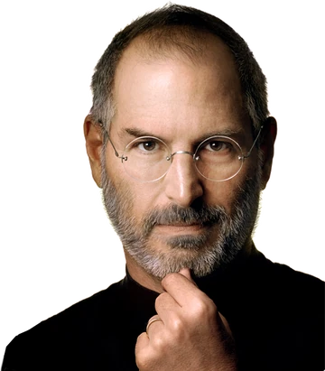

<!-- _class: stack -->

1995Steve JobsTriumph of the Nerds

«Everybody should learn how to program a computer, <b>because it teaches you how to think</b>.»

---

<!-- _class: stack -->

1995Steve JobsTriumph of the Nerds

«Everybody should learn how to program a computer, <b>because it teaches you how to think</b>.»

2013Barack Obamalancio dell'Hour of Code

«<b>Don't just play on your phone — program it.</b>»

---

<!-- _class: stack -->

1995Steve JobsTriumph of the Nerds

«Everybody should learn how to program a computer, <b>because it teaches you how to think</b>.»

2013Barack Obamalancio dell'Hour of Code

«<b>Don't just play on your phone — program it.</b>»

2024Jensen HuangWorld Governments Summit

«It's almost exactly the opposite. It is our job to create computing technology such that <b>nobody has to program</b>.»

---

<!-- _class: stack -->

1995Steve JobsTriumph of the Nerds

«Everybody should learn how to program a computer, <b>because it teaches you how to think</b>.»

2013Barack Obamalancio dell'Hour of Code

«<b>Don't just play on your phone — program it.</b>»

2024Jensen HuangWorld Governments Summit

«It's almost exactly the opposite. It is our job to create computing technology such that <b>nobody has to program</b>.»

2025Andrew NgSnowflake Build

«The bar to coding is <b>now lower than it ever has been</b>.»

---

<!-- _class: stack -->

1995Steve JobsTriumph of the Nerds

«Everybody should learn how to program a computer, <b>because it teaches you how to think</b>.»

2013Barack Obamalancio dell'Hour of Code

«<b>Don't just play on your phone — program it.</b>»

2024Jensen HuangWorld Governments Summit

«It's almost exactly the opposite. It is our job to create computing technology such that <b>nobody has to program</b>.»

2025Andrew NgSnowflake Build

«The bar to coding is <b>now lower than it ever has been</b>.»

2025Dario AmodeiCouncil on Foreign Relations

«In three to six months, AI is writing <b>90% of the code</b>.»

---

<!-- _class: stack -->

1995Steve JobsTriumph of the Nerds

«Everybody should learn how to program a computer, <b>because it teaches you how to think</b>.»

2013Barack Obamalancio dell'Hour of Code

«<b>Don't just play on your phone — program it.</b>»

2024Jensen HuangWorld Governments Summit

«It's almost exactly the opposite. It is our job to create computing technology such that <b>nobody has to program</b>.»

2025Andrew NgSnowflake Build

«The bar to coding is <b>now lower than it ever has been</b>.»

2025Dario AmodeiCouncil on Foreign Relations

«In three to six months, AI is writing <b>90% of the code</b>.»

2025Jensen HuangVivaTech · su Amodei

«I pretty much <b>disagree with almost everything</b> he says.»

---

<!-- _class: stack -->

1995Steve JobsTriumph of the Nerds

«Everybody should learn how to program a computer, <b>because it teaches you how to think</b>.»

2013Barack Obamalancio dell'Hour of Code

«<b>Don't just play on your phone — program it.</b>»

2024Jensen HuangWorld Governments Summit

«It's almost exactly the opposite. It is our job to create computing technology such that <b>nobody has to program</b>.»

2025Andrew NgSnowflake Build

«The bar to coding is <b>now lower than it ever has been</b>.»

2025Dario AmodeiCouncil on Foreign Relations

«In three to six months, AI is writing <b>90% of the code</b>.»

2025Jensen HuangVivaTech · su Amodei

«I pretty much <b>disagree with almost everything</b> he says.»

2026Nickle LaMoreauxCHRO IBM

«Le aziende che avranno più successo sono quelle che <b>hanno raddoppiato sulle assunzioni entry-level</b>.»

---

<!-- _class: lead -->

# Tutto e il contrario di tutto.
