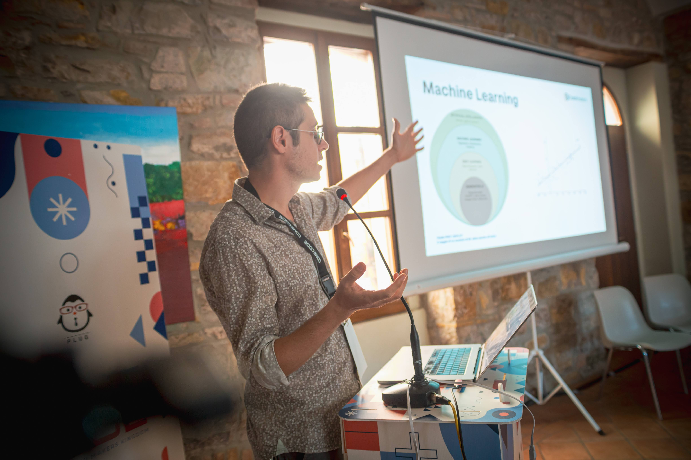
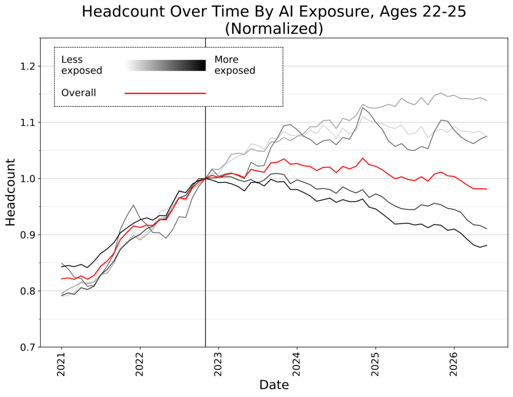
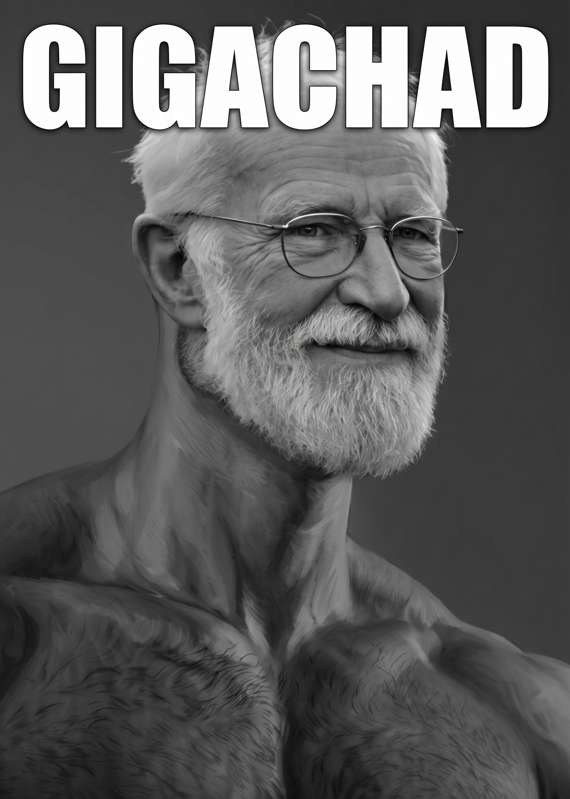
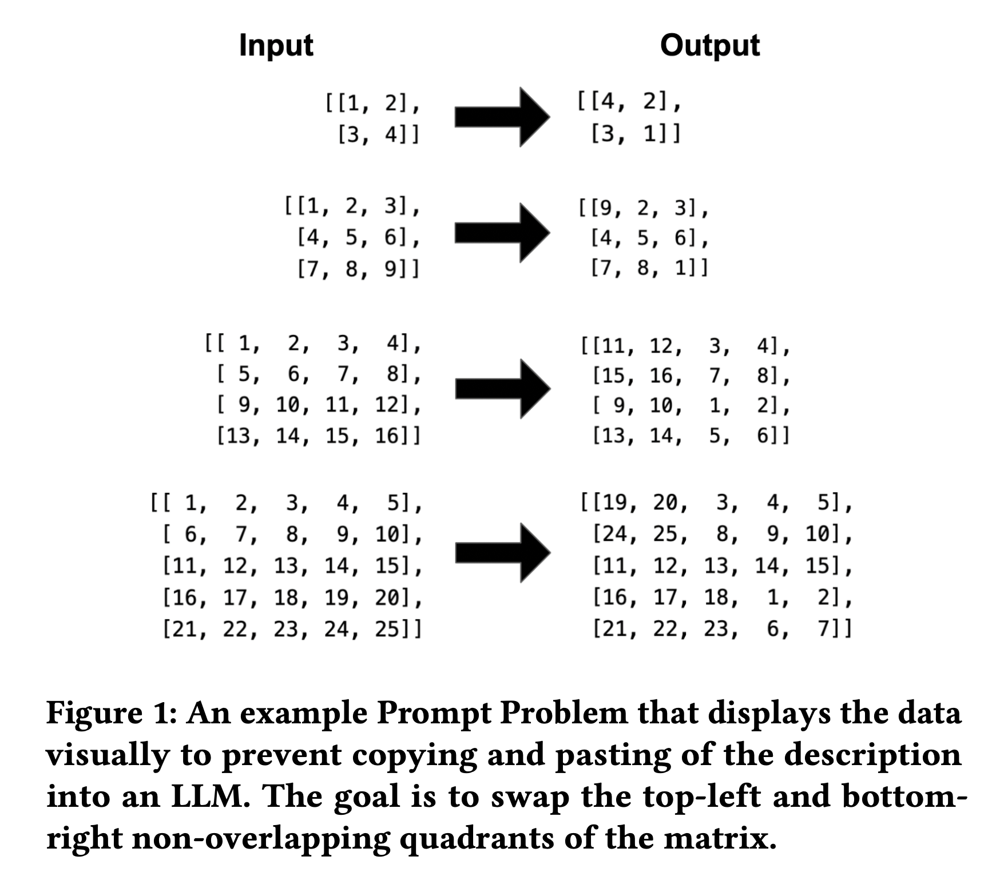

<!-- _class: lead -->
<!-- _paginate: false -->

### Giuseppe Mastrandrea

# Dovremmo ancora<br>insegnare a programmare<br>nell'era degli LLM?

<div style="width:56px; height:2px; background:var(--a); margin:30px auto 24px;"></div>

<div style="font-size:0.8em; color:var(--label);">Come To Code 2026 - Pignola</div>

<div class="mono dim" style="font-size:0.5em; margin-top:10px;">27 settembre 2026</div>

<!--
Niente. Si legge da sola. Eventualmente: "il titolo è una domanda vera, non retorica. Alla fine vi do la mia risposta, ma voglio che ci arriviate con i dati in mano."
-->

---

### Hello, world!

# Mi presento

<div style="display:flex; align-items:center; gap:52px; margin-top:22px;">
  <div style="flex:1; display:flex; flex-direction:column; gap:16px; font-size:0.94em;">
    <div><strong>Ingegnere informatico</strong> con la passione per la letteratura.</div>
    <div><strong>Sviluppatore.</strong></div>
    <div><strong>Insegnante di informatica.</strong></div>
    <div><strong>Formatore professionale.</strong></div>
  </div>
  <div style="flex:0 0 400px;">
    <div style="width:400px; height:400px; overflow:hidden; border-radius:12px;">
      
    </div>
    <div class="mono dim" style="font-size:0.44em; margin-top:8px;">Come To Code 2024</div>
  </div>
</div>

<!--
Il punto non è il CV, è stabilire da dove parli: sono le tre persone che questo problema riguarda contemporaneamente. Quello che scriveva codice e ora lo fa scrivere. Quello che deve decidere cosa mettere nel programma di quest'anno. E quello che ha davanti persone di 40 anni che si stanno riqualificando e mi chiedono se stanno buttando via un anno di vita.

Chiudi con: "Non ho una risposta comoda. Ho dei dati."
-->

---
# Di cosa parliamo

<div style="margin-top:26px; font-size:0.78em;">
  <div class="fade r1" style="display:flex; align-items:baseline; gap:26px; padding:13px 0; border-bottom:1px solid var(--b);">
    <div class="mono amber" style="flex:0 0 60px; font-size:0.72em;">01</div>
    <div style="flex:0 0 330px;"><strong>Cosa dicono i dati</strong></div>
    <div style="flex:1; color:var(--body); font-size:0.88em;">chi non viene più assunto, e dove</div>
  </div>
  <div class="fade r2" style="display:flex; align-items:baseline; gap:26px; padding:13px 0; border-bottom:1px solid var(--b);">
    <div class="mono amber" style="flex:0 0 60px; font-size:0.72em;">02</div>
    <div style="flex:0 0 330px;"><strong>Cosa fa davvero la macchina</strong></div>
    <div style="flex:1; color:var(--body); font-size:0.88em;">produrre non è più il problema</div>
  </div>
  <div class="fade r3" style="display:flex; align-items:baseline; gap:26px; padding:13px 0; border-bottom:1px solid var(--b);">
    <div class="mono amber" style="flex:0 0 60px; font-size:0.72em;">03</div>
    <div style="flex:0 0 330px;"><strong>Cosa resta da insegnare</strong></div>
    <div style="flex:1; color:var(--body); font-size:0.88em;">le competenze che non scadono</div>
  </div>
  <div class="fade r4" style="display:flex; align-items:baseline; gap:26px; padding:13px 0; border-bottom:1px solid var(--b);">
    <div class="mono amber" style="flex:0 0 60px; font-size:0.72em;">04</div>
    <div style="flex:0 0 330px;"><strong>L'AI in aula: sì o no?</strong></div>
    <div style="flex:1; color:var(--body); font-size:0.88em;">quattro studi, una domanda sbagliata</div>
  </div>
  <div class="fade r5" style="display:flex; align-items:baseline; gap:26px; padding:13px 0;">
    <div class="mono amber" style="flex:0 0 60px; font-size:0.72em;">05</div>
    <div style="flex:0 0 330px;"><strong>Nuove idee per insegnare</strong></div>
    <div style="flex:1; color:var(--body); font-size:0.88em;">cinque idee per insegnare il coding</div>
  </div>
</div>

<!--
Veloce, è solo una mappa: dieci secondi in tutto.

"Partiamo dai dati sul mercato del lavoro, poi guardiamo cosa fa davvero la macchina al mestiere, poi cosa resta da insegnare, poi cosa dice la ricerca sull'usarla in aula. E chiudiamo con cinque esercizi che vi faccio provare."

Se serve una frase di chiusura: "Non ho una risposta comoda. Ho dei dati."
-->

---


<!-- _class: stack -->
<!-- _footer: '' -->

<div class="wrap"><div class="c" style="left:66px; top:66px; transform:rotate(-0.7deg); z-index:1;"><div class="hd"><span class="yr">1995</span><span class="nm">Steve Jobs</span><span class="src">Triumph of the Nerds</span></div><div class="q">«Everybody should learn how to program a computer, <b>because it teaches you how to think</b>.»</div></div></div>

<!--
Prima citazione. "Jobs, 1995. Imparare a programmare ti insegna a pensare. È la frase su cui abbiamo costruito trent'anni di didattica."
-->

---

<!-- _class: stack -->
<!-- _footer: '' -->

<div class="wrap"><div class="c dim" style="left:66px; top:66px; transform:rotate(-0.7deg); z-index:1;"><div class="hd"><span class="yr">1995</span><span class="nm">Steve Jobs</span><span class="src">Triumph of the Nerds</span></div><div class="q">«Everybody should learn how to program a computer, <b>because it teaches you how to think</b>.»</div></div><div class="c" style="left:90px; top:132px; transform:rotate(0.5deg); z-index:2;"><div class="hd"><span class="yr">2013</span><span class="nm">Barack Obama</span><span class="src">lancio dell'Hour of Code</span></div><div class="q">«<b>Don't just play on your phone - program it.</b>»</div></div></div>

<!--
"Diciotto anni dopo, un presidente degli Stati Uniti dice esattamente la stessa cosa."
-->

---

<!-- _class: stack -->
<!-- _footer: '' -->

<div class="wrap"><div class="c dim" style="left:66px; top:66px; transform:rotate(-0.7deg); z-index:1;"><div class="hd"><span class="yr">1995</span><span class="nm">Steve Jobs</span><span class="src">Triumph of the Nerds</span></div><div class="q">«Everybody should learn how to program a computer, <b>because it teaches you how to think</b>.»</div></div><div class="c dim" style="left:90px; top:132px; transform:rotate(0.5deg); z-index:2;"><div class="hd"><span class="yr">2013</span><span class="nm">Barack Obama</span><span class="src">lancio dell'Hour of Code</span></div><div class="q">«<b>Don't just play on your phone - program it.</b>»</div></div><div class="c" style="left:114px; top:198px; transform:rotate(-0.45deg); z-index:3;"><div class="hd"><span class="yr">2024</span><span class="nm">Jensen Huang</span><span class="src">World Governments Summit</span></div><div class="q">«It's almost exactly the opposite. It is our job to create computing technology such that <b>nobody has to program</b>.»</div></div></div>

<!--
"E poi, 2024. Huang non dice che è cambiato qualcosa. Dice che è esattamente il contrario."
-->

---

<!-- _class: stack -->
<!-- _footer: '' -->

<div class="wrap"><div class="c dim" style="left:66px; top:66px; transform:rotate(-0.7deg); z-index:1;"><div class="hd"><span class="yr">1995</span><span class="nm">Steve Jobs</span><span class="src">Triumph of the Nerds</span></div><div class="q">«Everybody should learn how to program a computer, <b>because it teaches you how to think</b>.»</div></div><div class="c dim" style="left:90px; top:132px; transform:rotate(0.5deg); z-index:2;"><div class="hd"><span class="yr">2013</span><span class="nm">Barack Obama</span><span class="src">lancio dell'Hour of Code</span></div><div class="q">«<b>Don't just play on your phone - program it.</b>»</div></div><div class="c dim" style="left:114px; top:198px; transform:rotate(-0.45deg); z-index:3;"><div class="hd"><span class="yr">2024</span><span class="nm">Jensen Huang</span><span class="src">World Governments Summit</span></div><div class="q">«It's almost exactly the opposite. It is our job to create computing technology such that <b>nobody has to program</b>.»</div></div><div class="c" style="left:138px; top:264px; transform:rotate(0.7deg); z-index:4;"><div class="hd"><span class="yr">2025</span><span class="nm">Andrew Ng</span><span class="src">Snowflake Build</span></div><div class="q">«The bar to coding is <b>now lower than it ever has been</b>.»</div></div></div>

<!--
"2025. Il pendolo riparte."
-->

---

<!-- _class: stack -->
<!-- _footer: '' -->

<div class="wrap"><div class="c dim" style="left:66px; top:66px; transform:rotate(-0.7deg); z-index:1;"><div class="hd"><span class="yr">1995</span><span class="nm">Steve Jobs</span><span class="src">Triumph of the Nerds</span></div><div class="q">«Everybody should learn how to program a computer, <b>because it teaches you how to think</b>.»</div></div><div class="c dim" style="left:90px; top:132px; transform:rotate(0.5deg); z-index:2;"><div class="hd"><span class="yr">2013</span><span class="nm">Barack Obama</span><span class="src">lancio dell'Hour of Code</span></div><div class="q">«<b>Don't just play on your phone - program it.</b>»</div></div><div class="c dim" style="left:114px; top:198px; transform:rotate(-0.45deg); z-index:3;"><div class="hd"><span class="yr">2024</span><span class="nm">Jensen Huang</span><span class="src">World Governments Summit</span></div><div class="q">«It's almost exactly the opposite. It is our job to create computing technology such that <b>nobody has to program</b>.»</div></div><div class="c dim" style="left:138px; top:264px; transform:rotate(0.7deg); z-index:4;"><div class="hd"><span class="yr">2025</span><span class="nm">Andrew Ng</span><span class="src">Snowflake Build</span></div><div class="q">«The bar to coding is <b>now lower than it ever has been</b>.»</div></div><div class="c" style="left:162px; top:330px; transform:rotate(-0.6deg); z-index:5;"><div class="hd"><span class="yr">2025</span><span class="nm">Dario Amodei</span><span class="src">Council on Foreign Relations</span></div><div class="q">«In three to six months, AI is writing <b>90% of the code</b>.»</div></div></div>

<!--
"Due mesi dopo, stessa constatazione, conclusione opposta."
-->

---

<!-- _class: stack -->
<!-- _footer: '' -->

<div class="wrap"><div class="c dim" style="left:66px; top:66px; transform:rotate(-0.7deg); z-index:1;"><div class="hd"><span class="yr">1995</span><span class="nm">Steve Jobs</span><span class="src">Triumph of the Nerds</span></div><div class="q">«Everybody should learn how to program a computer, <b>because it teaches you how to think</b>.»</div></div><div class="c dim" style="left:90px; top:132px; transform:rotate(0.5deg); z-index:2;"><div class="hd"><span class="yr">2013</span><span class="nm">Barack Obama</span><span class="src">lancio dell'Hour of Code</span></div><div class="q">«<b>Don't just play on your phone - program it.</b>»</div></div><div class="c dim" style="left:114px; top:198px; transform:rotate(-0.45deg); z-index:3;"><div class="hd"><span class="yr">2024</span><span class="nm">Jensen Huang</span><span class="src">World Governments Summit</span></div><div class="q">«It's almost exactly the opposite. It is our job to create computing technology such that <b>nobody has to program</b>.»</div></div><div class="c dim" style="left:138px; top:264px; transform:rotate(0.7deg); z-index:4;"><div class="hd"><span class="yr">2025</span><span class="nm">Andrew Ng</span><span class="src">Snowflake Build</span></div><div class="q">«The bar to coding is <b>now lower than it ever has been</b>.»</div></div><div class="c dim" style="left:162px; top:330px; transform:rotate(-0.6deg); z-index:5;"><div class="hd"><span class="yr">2025</span><span class="nm">Dario Amodei</span><span class="src">Council on Foreign Relations</span></div><div class="q">«In three to six months, AI is writing <b>90% of the code</b>.»</div></div><div class="c" style="left:186px; top:396px; transform:rotate(0.45deg); z-index:6;"><div class="hd"><span class="yr">2025</span><span class="nm">Jensen Huang</span><span class="src">VivaTech - su Amodei</span></div><div class="q">«I pretty much <b>disagree with almost everything</b> he says.»</div></div></div>

<!--
Il momento comico. "Lo stesso Huang di prima. Che demolisce Amodei." Pausa breve.
-->

---

<!-- _class: stack -->
<!-- _footer: 'Jobs 1995 - Obama 2013 - Huang 2024 (WGS) - Ng 2025 - Amodei 2025 (CFR) - Huang 2025 (VivaTech) - LaMoreaux 2026 (IBM)' -->

<div class="wrap"><div class="c dim" style="left:66px; top:66px; transform:rotate(-0.7deg); z-index:1;"><div class="hd"><span class="yr">1995</span><span class="nm">Steve Jobs</span><span class="src">Triumph of the Nerds</span></div><div class="q">«Everybody should learn how to program a computer, <b>because it teaches you how to think</b>.»</div></div><div class="c dim" style="left:90px; top:132px; transform:rotate(0.5deg); z-index:2;"><div class="hd"><span class="yr">2013</span><span class="nm">Barack Obama</span><span class="src">lancio dell'Hour of Code</span></div><div class="q">«<b>Don't just play on your phone - program it.</b>»</div></div><div class="c dim" style="left:114px; top:198px; transform:rotate(-0.45deg); z-index:3;"><div class="hd"><span class="yr">2024</span><span class="nm">Jensen Huang</span><span class="src">World Governments Summit</span></div><div class="q">«It's almost exactly the opposite. It is our job to create computing technology such that <b>nobody has to program</b>.»</div></div><div class="c dim" style="left:138px; top:264px; transform:rotate(0.7deg); z-index:4;"><div class="hd"><span class="yr">2025</span><span class="nm">Andrew Ng</span><span class="src">Snowflake Build</span></div><div class="q">«The bar to coding is <b>now lower than it ever has been</b>.»</div></div><div class="c dim" style="left:162px; top:330px; transform:rotate(-0.6deg); z-index:5;"><div class="hd"><span class="yr">2025</span><span class="nm">Dario Amodei</span><span class="src">Council on Foreign Relations</span></div><div class="q">«In three to six months, AI is writing <b>90% of the code</b>.»</div></div><div class="c dim" style="left:186px; top:396px; transform:rotate(0.45deg); z-index:6;"><div class="hd"><span class="yr">2025</span><span class="nm">Jensen Huang</span><span class="src">VivaTech - su Amodei</span></div><div class="q">«I pretty much <b>disagree with almost everything</b> he says.»</div></div><div class="c" style="left:210px; top:462px; transform:rotate(-0.35deg); z-index:7;"><div class="hd"><span class="yr">2026</span><span class="nm">Nickle LaMoreaux</span><span class="src">CHRO IBM</span></div><div class="q">«Le aziende che avranno più successo sono quelle che <b>hanno raddoppiato sulle assunzioni entry-level</b>.»</div></div></div>

<!--
"E infine un HR, non un CEO. Che contraddice tutti quanti con una decisione operativa." Da qui si passa alla slide dopo senza commentare.
-->

---

<!-- _class: lead -->

# Tutto e il contrario<br>di tutto.

<!--
"In trent'anni - da Jobs a IBM - il pendolo ha fatto un giro completo e mezzo. E queste sono le persone che decidono dove va l'industria. Io invece devo decidere cosa scrivo nel programma di settembre. Quindi smetto di guardare le dichiarazioni e guardo i dati."
-->

---

<!-- _class: card -->

### Parte 1

# Cosa dicono i dati

<!-- "Niente aneddoti. Buste paga." -->

---
<!-- _footer: "" -->

# Il canarino nella miniera

<div style="display:flex; align-items:center; gap:44px; margin-top:22px;">
  <div style="flex:0 0 430px;">
    
    <div class="mono dim" style="font-size:0.42em; margin-top:8px;">Foto di George McCaa, U.S. Bureau of Mines, 1928.</div>
  </div>
  <div style="flex:1; font-size:0.74em; line-height:1.6; color:var(--body);">
    <div>I minatori portavano sottoterra un <strong>canarino in gabbia</strong>.</div>
    <div style="margin-top:16px;">Un uccello respira molto più aria di un uomo, a parità di peso. Se in galleria c'è monossido di carbonio, <strong>il canarino si avvelena molto prima</strong>.</div>
    <div style="margin-top:16px;">Quando <strong class="fall">smette di cantare</strong>, si esce.</div>
  </div>
</div>

<!--
«Fine Ottocento, miniere di carbone. L'idea è di un fisiologo scozzese, John Scott Haldane: i minatori scendono con una gabbietta e dentro un canarino.»

«Funziona per una ragione fisiologica precisa: gli uccelli hanno i sacchi aerei, estraggono ossigeno sia quando inspirano sia quando espirano, quindi assorbono molta più aria per unità di peso. Il monossido di carbonio li prende molto prima di noi.»

«Finché canta, si lavora. Quando smette, si esce. E si esce SENZA sapere cosa ci sia nell'aria e perché: il canarino non fa una diagnosi, dà un allarme.»

«Nel Regno Unito li hanno usati ufficialmente fino al 1986, poi sono arrivati i rilevatori elettronici.»

E QUI SI CONSEGNA ALLA SLIDE DOPO: «tenete a mente questa cosa, perché lo studio che sto per mostrarvi si intitola esattamente così, e il titolo è già l'avvertenza.»
-->

---


<!-- _footer: 'Stanford Digital Economy Lab / NBER - versione agosto 2026' -->

# Canaries in the Coal Mine?

<div style="font-size:0.8em; color:var(--label); margin:-4px 0 26px;">Brynjolfsson - Chandar - Chen - Stanford Digital Economy Lab</div>

<div class="method">
DATI: BUSTE PAGA ADP
</div>

<!--
"Questo studio conta più degli altri per un motivo solo: non chiede alle persone cosa pensano dell'AI, guarda chi viene pagato ogni mese."

ATTENZIONE alla precisione. "Non è un sondaggio" vale per COME CONTANO LE PERSONE, non per come classificano l'esposizione - quella è un giudizio esterno, e lo vediamo fra due slide.

Il prezzo del sottoprodotto dillo tu: ADP è il più grande gestore di buste paga degli Stati Uniti, ma resta un campione. Gli autori stessi dicono che è più marcato dei benchmark nazionali.
-->

---

<!-- _footer: 'Canaries in the Coal Mine?, Stanford Digital Economy Lab - agosto 2026' -->

### Cosa studia

<div style="display:flex; flex-direction:column; justify-content:center; height:380px; gap:26px;">
  <div class="claim" style="max-width:30ch;">Nei mestieri più <b>esposti all'AI</b>, l'occupazione si è mossa diversamente?</div>
  <div class="claim">Per <b>chi</b>?</div>
  <div class="claim">In che <b>modo</b>?</div>
</div>

<!--
"Qui c'è la domanda che mi fanno sempre: le buste paga dove entrano? Entrano come ESITO. Ti dicono quante persone ci sono, che età hanno, quanto prendono. Non ti dicono niente sull'AI."

"L'esposizione arriva da fuori: è un giudizio su quanto una professione è aggredibile, calcolato su come è fatto il lavoro."

"E si incastrano sul codice della professione. La busta paga dice 'questo è uno sviluppatore', la tabella dell'esposizione dice 'gli sviluppatori sono esposti così'. Il codice è la giuntura."
-->

---
<!-- _footer: 'Canaries in the Coal Mine?, Tab. D.2 - le cinque professioni più numerose per uomini e per donne in ciascun quintile, campione ADP 2022' -->

# Cosa vuol dire «esposto»

<div style="font-size:0.72em; color:var(--body); line-height:1.5; margin:-2px 0 20px; max-width:70ch;">
Tutte le professioni americane messe in fila per <strong>quanto del loro lavoro un'AI può fare</strong>.<span class="amber">*</span>
</div>

<div style="font-size:0.6em;"><div style="display:flex; align-items:flex-start; gap:20px; padding:9px 0; border-bottom:1px solid var(--b); opacity:1.0;"><div class="mono" style="flex:0 0 40px; color:var(--rise);">Q1</div><div class="mono" style="flex:0 0 118px; color:var(--rise); font-size:0.78em;">MENO ESPOSTE</div><div style="flex:1; color:var(--body); line-height:1.45;">Movimentazione merci a mano, addetti alle pulizie, carrellisti, giardinaggio, confezionamento, assistenti domiciliari, addetti alle pulizie industriali</div></div><div style="display:flex; align-items:center; gap:20px; padding:9px 0; border-bottom:1px dashed var(--b); opacity:0.3;"><div class="mono" style="flex:0 0 40px; color:var(--m);">Q2</div><div style="flex:1; border-top:1px dotted var(--m); height:1px;"></div></div><div style="display:flex; align-items:center; gap:20px; padding:9px 0; border-bottom:1px dashed var(--b); opacity:0.3;"><div class="mono" style="flex:0 0 40px; color:var(--m);">Q3</div><div style="flex:1; border-top:1px dotted var(--m); height:1px;"></div></div><div style="display:flex; align-items:center; gap:20px; padding:9px 0; border-bottom:1px dashed var(--b); opacity:0.3;"><div class="mono" style="flex:0 0 40px; color:var(--m);">Q4</div><div style="flex:1; border-top:1px dotted var(--m); height:1px;"></div></div><div style="display:flex; align-items:center; gap:20px; padding:9px 0; border-bottom:1px dashed var(--b); opacity:0.3;"><div class="mono" style="flex:0 0 40px; color:var(--m);">Q5</div><div style="flex:1; border-top:1px dotted var(--m); height:1px;"></div></div></div>

<div class="mono dim" style="font-size:0.42em; margin-top:18px;"><span class="amber">*</span> Punteggio di esposizione da Eloundou et al. 2024 (<i>Science</i>), calcolato con GPT-4 sulle mansioni O*NET.</div>

<!--
«Si prendono tutte le professioni americane, si dà a ciascuna un punteggio di quanto un'AI può fare del suo lavoro, si mettono in fila e si taglia in cinque gruppi uguali. In fondo alla fila, il quintile uno: lavori che si fanno con le mani e sul posto.»
-->

---

<!-- _footer: 'Canaries in the Coal Mine?, Tab. D.2 - le cinque professioni più numerose per uomini e per donne in ciascun quintile, campione ADP 2022' -->

# Cosa vuol dire «esposto»

<div style="font-size:0.72em; color:var(--body); line-height:1.5; margin:-2px 0 20px; max-width:70ch;">
Tutte le professioni americane messe in fila per <strong>quanto del loro lavoro un'AI può fare</strong>.<span class="amber">*</span>
</div>

<div style="font-size:0.6em;"><div style="display:flex; align-items:flex-start; gap:20px; padding:9px 0; border-bottom:1px solid var(--b); opacity:0.62;"><div class="mono" style="flex:0 0 40px; color:var(--rise);">Q1</div><div class="mono" style="flex:0 0 118px; color:var(--rise); font-size:0.78em;">MENO ESPOSTE</div><div style="flex:1; color:var(--body); line-height:1.45;">Movimentazione merci a mano, addetti alle pulizie, carrellisti, giardinaggio, confezionamento, assistenti domiciliari, addetti alle pulizie industriali</div></div><div style="display:flex; align-items:flex-start; gap:20px; padding:9px 0; border-bottom:1px solid var(--b); opacity:1.0;"><div class="mono" style="flex:0 0 40px; color:var(--label);">Q2</div><div style="flex:0 0 118px;"></div><div style="flex:1; color:var(--body); line-height:1.45;">Manutentori, assistenti infermieristici, aiutanti di produzione, magazzinieri, saldatori, macchinisti utensili, camerieri</div></div><div style="display:flex; align-items:center; gap:20px; padding:9px 0; border-bottom:1px dashed var(--b); opacity:0.3;"><div class="mono" style="flex:0 0 40px; color:var(--m);">Q3</div><div style="flex:1; border-top:1px dotted var(--m); height:1px;"></div></div><div style="display:flex; align-items:center; gap:20px; padding:9px 0; border-bottom:1px dashed var(--b); opacity:0.3;"><div class="mono" style="flex:0 0 40px; color:var(--m);">Q4</div><div style="flex:1; border-top:1px dotted var(--m); height:1px;"></div></div><div style="display:flex; align-items:center; gap:20px; padding:9px 0; border-bottom:1px dashed var(--b); opacity:0.3;"><div class="mono" style="flex:0 0 40px; color:var(--m);">Q5</div><div style="flex:1; border-top:1px dotted var(--m); height:1px;"></div></div></div>

<div class="mono dim" style="font-size:0.42em; margin-top:18px;"><span class="amber">*</span> Punteggio di esposizione da Eloundou et al. 2024 (<i>Science</i>), calcolato con GPT-4 sulle mansioni O*NET.</div>

<!--
«Salendo: manutenzione, magazzino, ristorazione. Ancora lavoro fisico, ma con più procedure.»
-->

---

<!-- _footer: 'Canaries in the Coal Mine?, Tab. D.2 - le cinque professioni più numerose per uomini e per donne in ciascun quintile, campione ADP 2022' -->

# Cosa vuol dire «esposto»

<div style="font-size:0.72em; color:var(--body); line-height:1.5; margin:-2px 0 20px; max-width:70ch;">
Tutte le professioni americane messe in fila per <strong>quanto del loro lavoro un'AI può fare</strong>.<span class="amber">*</span>
</div>

<div style="font-size:0.6em;"><div style="display:flex; align-items:flex-start; gap:20px; padding:9px 0; border-bottom:1px solid var(--b); opacity:0.51;"><div class="mono" style="flex:0 0 40px; color:var(--rise);">Q1</div><div class="mono" style="flex:0 0 118px; color:var(--rise); font-size:0.78em;">MENO ESPOSTE</div><div style="flex:1; color:var(--body); line-height:1.45;">Movimentazione merci a mano, addetti alle pulizie, carrellisti, giardinaggio, confezionamento, assistenti domiciliari, addetti alle pulizie industriali</div></div><div style="display:flex; align-items:flex-start; gap:20px; padding:9px 0; border-bottom:1px solid var(--b); opacity:0.62;"><div class="mono" style="flex:0 0 40px; color:var(--label);">Q2</div><div style="flex:0 0 118px;"></div><div style="flex:1; color:var(--body); line-height:1.45;">Manutentori, assistenti infermieristici, aiutanti di produzione, magazzinieri, saldatori, macchinisti utensili, camerieri</div></div><div style="display:flex; align-items:flex-start; gap:20px; padding:9px 0; border-bottom:1px solid var(--b); opacity:1.0;"><div class="mono" style="flex:0 0 40px; color:var(--label);">Q3</div><div style="flex:0 0 118px;"></div><div style="flex:1; color:var(--body); line-height:1.45;">Tassisti e autisti, infermieri, camionisti, assistenti medici, addetti alle vendite, responsabili servizi sociali, programmatori di macchine CNC, capi servizi di pulizia, infermieri professionali</div></div><div style="display:flex; align-items:center; gap:20px; padding:9px 0; border-bottom:1px dashed var(--b); opacity:0.3;"><div class="mono" style="flex:0 0 40px; color:var(--m);">Q4</div><div style="flex:1; border-top:1px dotted var(--m); height:1px;"></div></div><div style="display:flex; align-items:center; gap:20px; padding:9px 0; border-bottom:1px dashed var(--b); opacity:0.3;"><div class="mono" style="flex:0 0 40px; color:var(--m);">Q5</div><div style="flex:1; border-top:1px dotted var(--m); height:1px;"></div></div></div>

<div class="mono dim" style="font-size:0.42em; margin-top:18px;"><span class="amber">*</span> Punteggio di esposizione da Eloundou et al. 2024 (<i>Science</i>), calcolato con GPT-4 sulle mansioni O*NET.</div>

<!--
«A metà: sanità, trasporti, vendita. Qui il lavoro è fatto di persone e di presenza.»
-->

---

<!-- _footer: 'Canaries in the Coal Mine?, Tab. D.2 - le cinque professioni più numerose per uomini e per donne in ciascun quintile, campione ADP 2022' -->

# Cosa vuol dire «esposto»

<div style="font-size:0.72em; color:var(--body); line-height:1.5; margin:-2px 0 20px; max-width:70ch;">
Tutte le professioni americane messe in fila per <strong>quanto del loro lavoro un'AI può fare</strong>.<span class="amber">*</span>
</div>

<div style="font-size:0.6em;"><div style="display:flex; align-items:flex-start; gap:20px; padding:9px 0; border-bottom:1px solid var(--b); opacity:0.4;"><div class="mono" style="flex:0 0 40px; color:var(--rise);">Q1</div><div class="mono" style="flex:0 0 118px; color:var(--rise); font-size:0.78em;">MENO ESPOSTE</div><div style="flex:1; color:var(--body); line-height:1.45;">Movimentazione merci a mano, addetti alle pulizie, carrellisti, giardinaggio, confezionamento, assistenti domiciliari, addetti alle pulizie industriali</div></div><div style="display:flex; align-items:flex-start; gap:20px; padding:9px 0; border-bottom:1px solid var(--b); opacity:0.51;"><div class="mono" style="flex:0 0 40px; color:var(--label);">Q2</div><div style="flex:0 0 118px;"></div><div style="flex:1; color:var(--body); line-height:1.45;">Manutentori, assistenti infermieristici, aiutanti di produzione, magazzinieri, saldatori, macchinisti utensili, camerieri</div></div><div style="display:flex; align-items:flex-start; gap:20px; padding:9px 0; border-bottom:1px solid var(--b); opacity:0.62;"><div class="mono" style="flex:0 0 40px; color:var(--label);">Q3</div><div style="flex:0 0 118px;"></div><div style="flex:1; color:var(--body); line-height:1.45;">Tassisti e autisti, infermieri, camionisti, assistenti medici, addetti alle vendite, responsabili servizi sociali, programmatori di macchine CNC, capi servizi di pulizia, infermieri professionali</div></div><div style="display:flex; align-items:flex-start; gap:20px; padding:9px 0; border-bottom:1px solid var(--b); opacity:1.0;"><div class="mono" style="flex:0 0 40px; color:var(--label);">Q4</div><div style="flex:0 0 118px;"></div><div style="flex:1; color:var(--body); line-height:1.45;">Responsabili vendite, direttori generali e operativi, direttori sanitari, capi reparto produzione, direttori di produzione, capi ufficio amministrativo, marketing manager</div></div><div style="display:flex; align-items:center; gap:20px; padding:9px 0; border-bottom:1px dashed var(--b); opacity:0.3;"><div class="mono" style="flex:0 0 40px; color:var(--m);">Q5</div><div style="flex:1; border-top:1px dotted var(--m); height:1px;"></div></div></div>

<div class="mono dim" style="font-size:0.42em; margin-top:18px;"><span class="amber">*</span> Punteggio di esposizione da Eloundou et al. 2024 (<i>Science</i>), calcolato con GPT-4 sulle mansioni O*NET.</div>

<!--
«Quarto quintile: comincia il lavoro di coordinamento. Capi reparto, responsabili. Molte riunioni, molti documenti.»
-->

---

<!-- _footer: 'Canaries in the Coal Mine?, Tab. D.2 - le cinque professioni più numerose per uomini e per donne in ciascun quintile, campione ADP 2022' -->

# Cosa vuol dire «esposto»

<div style="font-size:0.72em; color:var(--body); line-height:1.5; margin:-2px 0 20px; max-width:70ch;">
Tutte le professioni americane messe in fila per <strong>quanto del loro lavoro un'AI può fare</strong>.<span class="amber">*</span>
</div>

<div style="font-size:0.6em;"><div style="display:flex; align-items:flex-start; gap:20px; padding:9px 0; border-bottom:1px solid var(--b); opacity:0.29;"><div class="mono" style="flex:0 0 40px; color:var(--rise);">Q1</div><div class="mono" style="flex:0 0 118px; color:var(--rise); font-size:0.78em;">MENO ESPOSTE</div><div style="flex:1; color:var(--body); line-height:1.45;">Movimentazione merci a mano, addetti alle pulizie, carrellisti, giardinaggio, confezionamento, assistenti domiciliari, addetti alle pulizie industriali</div></div><div style="display:flex; align-items:flex-start; gap:20px; padding:9px 0; border-bottom:1px solid var(--b); opacity:0.4;"><div class="mono" style="flex:0 0 40px; color:var(--label);">Q2</div><div style="flex:0 0 118px;"></div><div style="flex:1; color:var(--body); line-height:1.45;">Manutentori, assistenti infermieristici, aiutanti di produzione, magazzinieri, saldatori, macchinisti utensili, camerieri</div></div><div style="display:flex; align-items:flex-start; gap:20px; padding:9px 0; border-bottom:1px solid var(--b); opacity:0.51;"><div class="mono" style="flex:0 0 40px; color:var(--label);">Q3</div><div style="flex:0 0 118px;"></div><div style="flex:1; color:var(--body); line-height:1.45;">Tassisti e autisti, infermieri, camionisti, assistenti medici, addetti alle vendite, responsabili servizi sociali, programmatori di macchine CNC, capi servizi di pulizia, infermieri professionali</div></div><div style="display:flex; align-items:flex-start; gap:20px; padding:9px 0; border-bottom:1px solid var(--b); opacity:0.62;"><div class="mono" style="flex:0 0 40px; color:var(--label);">Q4</div><div style="flex:0 0 118px;"></div><div style="flex:1; color:var(--body); line-height:1.45;">Responsabili vendite, direttori generali e operativi, direttori sanitari, capi reparto produzione, direttori di produzione, capi ufficio amministrativo, marketing manager</div></div><div style="display:flex; align-items:flex-start; gap:20px; padding:9px 0; opacity:1.0;"><div class="mono" style="flex:0 0 40px; color:var(--fall);">Q5</div><div class="mono" style="flex:0 0 118px; color:var(--fall); font-size:0.78em;">PIÙ ESPOSTE</div><div style="flex:1; color:var(--body); line-height:1.45;">Amministratori delegati, addetti al servizio clienti, contabili, <strong>sviluppatori</strong>, responsabili sistemi informativi, HR</div></div></div>

<div class="mono dim" style="font-size:0.42em; margin-top:18px;"><span class="amber">*</span> Punteggio di esposizione da Eloundou et al. 2024 (<i>Science</i>), calcolato con GPT-4 sulle mansioni O*NET.</div>

<!--
«E il quinto. Servizio clienti, contabilità, risorse umane - e sviluppo software.»

Pausa. È il momento in cui la sala capisce di essere sulla slide.

Poi la cosa più importante di tutta questa parte: «ESPOSIZIONE NON VUOL DIRE ADOZIONE. Non si misura chi usa l'AI: si misura quanto quel mestiere, per come è fatto, è aggredibile. Una professione sta nel quintile cinque anche se lì dentro non ha mai aperto un chatbot nessuno. Se misurassero l'adozione il ragionamento sarebbe circolare.»
-->

---


<!-- _footer: 'Figura originale del paper - Canaries in the Coal Mine?, Stanford Digital Economy Lab, ago 2026 - esposizione: Eloundou et al. 2024' -->

### Il divario

<div style="display:flex; align-items:center; gap:34px; margin-top:6px;">
  <div style="flex:0 0 560px;">
    
  </div>
  <div style="flex:1;">
    <div class="huge fall" style="font-size:3.9em;">19%</div>
    <div class="mono" style="font-size:0.44em; letter-spacing:0.08em; color:var(--m); margin:6px 0 22px; white-space:nowrap;">IN MENO RISPETTO AI MENO ESPOSTI</div>
    <div style="font-size:0.7em; line-height:1.55; color:var(--body);">
      Se avessero <strong>tenuto il passo</strong> dei coetanei nei lavori meno esposti, oggi i <strong>22–25enni</strong> sarebbero il 19% in più.
    </div>
    <div style="margin-top:12px; font-size:0.66em; line-height:1.5; color:var(--body);">
      Sui <strong class="rise">lavoratori esperti</strong>, stesse occupazioni, il divario <strong>non c'è</strong>.
    </div>
  </div>
</div>

<!--
Indica il grafico: "Cinque linee, i cinque quintili di cui parlavamo. La verticale è ChatGPT. Prima di quella riga vanno tutte insieme. Dopo si aprono: le due scure - le occupazioni più esposte - scendono sotto il livello di partenza, le chiare salgono."

"Questo è il loro grafico, non il mio. E il numero che ne esce è diciannove per cento."

Dillo bene, perché è la frase che ti contesteranno: non è "sono calati del 19%". È "sono indietro del 19% rispetto a dove sarebbero se fossero stati in un mestiere meno esposto".

"E il controllo che rende il dato credibile: sugli esperti, nelle stesse identiche occupazioni, quel divario non si vede. Se fosse un effetto generale dell'economia, lo vedresti su tutti."

ATTENZIONE: la figura usa le misure di esposizione di Eloundou et al. 2024 - c'è scritto nella didascalia originale. Se qualcuno chiede, è una delle due misure di cui hai parlato due slide fa.
-->

---
<!-- _footer: 'Canaries in the Coal Mine?, fatto n. 4 - il calo passa dalle mancate assunzioni, non dai licenziamenti' -->

# Foot in the door?

<div style="display:flex; align-items:center; gap:46px; margin-top:20px;">
  <div style="flex:1;">
    <div class="fade fade1" style="font-size:1.05em; line-height:1.4; color:var(--body);">
      <strong>19% di assunzioni mancate.</strong>
    </div>
    <div class="fade fade2" style="margin:14px 0 14px 4px;">
      <svg width="26" height="58" viewBox="0 0 26 58" aria-hidden="true">
        <line x1="8" y1="2" x2="8" y2="44" stroke="var(--a)" stroke-width="2"/>
        <path d="M2 38 L8 48 L14 38" fill="none" stroke="var(--a)" stroke-width="2" stroke-linecap="round" stroke-linejoin="round"/>
      </svg>
    </div>
    <div class="fade fade2" style="font-size:1.05em; line-height:1.4; color:var(--body);">
      La porta <strong>non si è aperta</strong>.
    </div>
  </div>
  <div style="flex:0 0 440px;">
    <video src="./assets/Trainspotting_5_12_Movie_CLIP_Spud_s_Job_Interview_1996_HD.mp4" autoplay muted loop playsinline style="width:100%; border-radius:8px; display:block;"></video>
  </div>
</div>

<!--
Dillo a voce, il clip: Trainspotting, 1996, il colloquio di lavoro di Spud.

"Per entrare in un mestiere serve un primo lavoro. Gli inglesi lo chiamano foot in the door: non ti serve che la porta si spalanchi, ti serve una fessura in cui infilare un piede."

"Quel diciannove per cento è fatto di assunzioni che non ci sono state. Gli autori sono espliciti: il calo passa dalle mancate assunzioni. Nessuno di quei ragazzi è stato licenziato, perché nessuno di loro era stato preso."

Pausa. Poi il motivo per cui non se ne parla: "un licenziamento è un evento, ha una data e una faccia, ci scrivi un articolo. Una porta che non si apre non è niente. Non c'è nessuno da intervistare."

NOTA TECNICA: il video parte da solo SOLO nell'anteprima e nell'export HTML. Nel PDF resta un fotogramma fermo. Se presenti dal PDF, il clip non parte: presenta dall'HTML o dall'anteprima Marp.
-->

---

<!-- _footer: "Avvertenze dichiarate dagli autori nell'abstract del paper" -->

# Causalità?

<div class="claim" style="font-size:1.5em; line-height:1.22; margin-top:26px;">
  «We interpret these facts as <b>early, descriptive indicators</b> - canaries in the coal mine - <b>rather than causal estimates</b>.»
</div>

<div style="display:flex; gap:26px; margin-top:34px; font-size:0.7em; color:var(--body);">
  <div style="flex:1;">Divergenze già <strong>prima di ChatGPT</strong>, attorno al COVID</div>
  <div style="flex:1;">A parità di <strong>titolo di studio</strong>, il divario fra quintili si attenua: le assunzioni sono più uniformi</div>
  <div style="flex:1;">Il campione ADP è <strong>più marcato</strong> dei benchmark nazionali</div>
</div>

<!--
Quindici secondi, non saltarla.

"Tre avvertenze che mettono gli autori stessi: le occupazioni esposte e non esposte divergevano già prima di ChatGPT, attorno al COVID; l'effetto si attenua se controlli per il titolo di studio - anche se loro stessi dicono che potrebbe essere proprio quello il canale attraverso cui l'AI agisce; e il campione ADP è più marcato dei benchmark nazionali."

"Quindi non vi sto dicendo 'l'AI ha causato questo'. Vi sto dicendo che il canarino ha smesso di cantare. È diverso, ed è comunque il motivo per cui si esce dalla miniera."

Quindici secondi e diventi l'unico speaker della giornata che cita i limiti dei propri dati.
-->

---
<!-- _footer: "Anthropic Economic Index, Handa et al. 2025 - il raggruppamento in due è la nota 40 del paper Stanford" -->

# Come si misura l'uso dell'AI

<div style="display:flex; align-items:center; gap:18px; margin-top:26px; font-size:0.66em; color:var(--body);">
  <div style="flex:1;"><span class="mono amber" style="font-size:0.72em; letter-spacing:0.1em;">01</span><div style="margin-top:8px;"><strong>Analisi delle conversazioni</strong></div></div>
  <div class="mono amber" style="flex:0 0 18px; font-size:0.9em;">&rarr;</div>
  <div style="flex:1;"><span class="mono amber" style="font-size:0.72em; letter-spacing:0.1em;">02</span><div style="margin-top:8px;"><strong>Labeling</strong> sul dataset O*NET</div></div>
  <div class="mono amber" style="flex:0 0 18px; font-size:0.9em;">&rarr;</div>
  <div style="flex:1;"><span class="mono amber" style="font-size:0.72em; letter-spacing:0.1em;">03</span><div style="margin-top:8px;"><strong>Aggregazione</strong> per professioni</div></div>
</div>

<div style="display:flex; gap:0; margin-top:34px; padding-top:22px; border-top:1px solid var(--b);">
  <div style="flex:1; padding-right:34px; border-right:1px solid var(--b);">
    <div class="mono" style="font-size:0.5em; letter-spacing:0.1em; color:var(--fall); margin-bottom:10px;">AUTOMATION</div>
    <div style="font-size:0.72em; color:var(--body);">Directive - Feedback Loop</div>
  </div>
  <div style="flex:1; padding-left:40px;">
    <div class="mono" style="font-size:0.5em; letter-spacing:0.1em; color:var(--rise); margin-bottom:10px;">AUGMENTATION</div>
    <div style="font-size:0.72em; color:var(--body);">Task Iteration - Learning - Validation</div>
  </div>
</div>

<!--
«Prima di usarlo, guardiamo come è costruito, perché non è una misura diretta.»

I tre passaggi, veloci: milioni di conversazioni, ognuna agganciata al compito O*NET a cui somiglia di più, e da lì alla professione. «Una conversazione anonima diventa un numero attaccato a sviluppatore software.»

Poi il pezzo che conta: «automativa non è una categoria dell'indice. Le categorie sono sei. Due vengono contate come automazione, tre come aumento, e la sesta è nessuna delle precedenti, che il modello è istruito a scegliere con larghezza.»

«Quindi quando dico automazione sto dicendo: due pattern conversazionali su sei, raggruppati così da Anthropic e adottati da Stanford.»

DA DIRE ANCHE: per moltissime professioni il traffico è quasi nullo. I primi due quintili di complementarità valgono lo 0,01% e lo 0,09% delle conversazioni; dal terzo al quinto stanno fra lo 0,33% e lo 0,47%. Gli autori rifanno tutto scartando le professioni a basso traffico e il risultato tiene.
-->

---
<!-- _footer: "Canaries in the Coal Mine?, fatto n. 5 - regressione congiunta per fascia d'età, Tab. 3" -->

# Due usi, due esiti

<div style="display:flex; gap:0; margin-top:30px;">
  <div style="flex:1; padding-right:38px; border-right:1px solid var(--b);">
    <div class="mono" style="font-size:0.5em; letter-spacing:0.1em; color:var(--fall); margin-bottom:14px;">AUTOMATION</div>
    <div style="font-size:0.78em; line-height:1.5; color:var(--body);">L'occupazione dei <strong>22-25enni</strong> <strong class="fall">diminuisce</strong>.</div>
    <div style="font-size:0.62em; line-height:1.55; color:var(--body); margin-top:18px;">Più sale la quota di uso automativo, più scende l'occupazione giovanile: circa il <strong>10% in meno</strong> a ogni scalino. Più aumenta l'età, più l'effetto si riduce.</div>
    <div style="font-size:0.58em; line-height:1.5; color:var(--body); margin-top:16px;"><span class="mono" style="font-size:0.8em; letter-spacing:0.08em; color:var(--m);">IN CIMA</span><br>Contabili e revisori, capi ufficio amministrativo, receptionist, business operations specialist.</div>
  </div>
  <div style="flex:1; padding-left:44px;">
    <div class="mono" style="font-size:0.5em; letter-spacing:0.1em; color:var(--rise); margin-bottom:14px;">AUGMENTATION</div>
    <div style="font-size:0.78em; line-height:1.5; color:var(--body);">L'occupazione dei 22-25enni <strong>non diminuisce</strong>,<br>quella degli <strong class="rise">over 41 aumenta</strong>.</div>
    <div style="font-size:0.62em; line-height:1.5; color:var(--body); margin-top:18px;">L'aumento è statisticamente significativo <strong>solo dai 41 anni in su</strong>.</div>
    <div style="font-size:0.58em; line-height:1.5; color:var(--body); margin-top:16px;"><span class="mono" style="font-size:0.8em; letter-spacing:0.08em; color:var(--m);">IN CIMA</span><br>Amministratori delegati, infermieri, manutentori, rappresentanti commerciali.</div>
  </div>
</div>

<div style="margin-top:30px; padding-top:18px; border-top:1px solid var(--b); font-size:0.68em; line-height:1.5; color:var(--body);">
Gli <strong>sviluppatori</strong> non sono fra le professioni più esposte ad automation. In cima ci sono i mestieri d'ufficio.
</div>

<!--
Questa è la conseguenza della slide prima: stessa misura, divisa in due, incrociata con le buste paga per fascia d'età.

"Dove l'uso prevalente è far eseguire il compito alla macchina, i ventidue-venticinquenni calano. Dove l'uso prevalente è farsi aiutare, i giovani non calano affatto e gli esperti crescono."

DI' ANCHE DOVE È PIÙ DEBOLE: l'effetto dell'automazione sui giovani è forte e significativo; quello della complementarità diventa significativo solo dai 41 anni in su. Non è simmetrico, e dirlo tu ti copre.

Gli autori la chiamano la loro prova più diretta sul meccanismo: «automation associated with declines for the young, complementarity with gains for the experienced».

NON CONFONDERE LE DUE MISURE. I quintili di prima vengono da Eloundou (quanto i compiti sono aggredibili in teoria); automazione e complementarità vengono da Anthropic (come la gente usa davvero il modello). Il paper le chiama «complementary measures» e le usa in analisi separate. Non dire «nei lavori più esposti l'AI sostituisce».

DI' CHIARAMENTE CHE QUESTO NON RIGUARDA LORO. Il risultato è trainato dalle professioni amministrative: contabili, segreteria, back office. Gli informatici compaiono nella lista dell'USO COMPLESSIVO (analisti di sistemi, amministratori di rete), che è un'altra misura. Non dire «quindi agli sviluppatori succede questo»: il dato sugli sviluppatori arriva dopo, ed è un altro.

La formulazione giusta è più forte: «e non è lo stesso dato guardato due volte. Uno è un giudizio sulle mansioni ufficiali, l'altro sono le conversazioni vere con un modello. Nessuna delle due sa dell'altra, e arrivano allo stesso posto.»

E la chiusura, lenta, perché è il ponte verso tutto il resto del talk: «la stessa tecnologia, usata in due modi diversi, produce disoccupazione o produttività. E come la usi si può insegnare.»

TOLTO DA QUESTA SLIDE il blocco conoscenza codificata / tacita: è un'interpretazione, non un risultato del paper, e sta meglio accanto a Naur nella Parte 3.
-->

---

<!-- _footer: 'Canaries in the Coal Mine?, quintile 5 - nota 22 sulla retribuzione dei 22–25enni' -->

# Focus: i developer

<div style="display:flex; gap:0; margin-top:20px;">
  <div style="flex:1; padding:24px 28px; padding-left:0; border-right:1px solid var(--b);">
    <div class="mono" style="font-size:0.5em; letter-spacing:0.1em; margin-bottom:14px; color:var(--fall);">DOVE STANNO</div>
    <div style="font-size:0.78em; line-height:1.6; color:var(--body);">Dentro il <strong>quintile più esposto</strong>. Insieme a servizio clienti e contabilità.</div>
  </div>
  <div style="flex:1; padding:24px 28px; padding-left:40px; padding-right:0;">
    <div class="mono amber" style="font-size:0.5em; letter-spacing:0.1em; margin-bottom:14px;">L'ANOMALIA</div>
    <div style="font-size:0.78em; line-height:1.6; color:var(--body);">La paga dei <strong>22–25enni</strong> è cresciuta <strong>più in fretta</strong>, non di meno.</div>
  </div>
</div>

<!--
"A questo punto la domanda della sala è una sola: e noi? E la risposta onesta è che il paper NON isola gli sviluppatori. Li colloca dentro il quintile più esposto."

"Ma c'è un'anomalia in più, ed è nelle note: la paga dei ventidue-venticinquenni in quelle occupazioni è cresciuta più in fretta, non di meno."

"La spiegazione più semplice non è bella: se smetti di assumere i meno pagati, la media di quelli che restano sale. Non è che pagano meglio. È che non prendono più la fascia bassa."

ATTENZIONE: non dire "paga d'ingresso". La nota parla della retribuzione dei 22-25enni, non dello stipendio iniziale dei neoassunti.
-->

---

<!-- _footer: 'Canaries in the Coal Mine?, Brynjolfsson - Chandar - Chen - Stanford Digital Economy Lab, ago 2026' -->

# Key takeaways

<div style="font-size:0.68em; line-height:1.62; color:var(--body); margin-top:14px;">
  <div style="margin-bottom:17px;">Ci sono mestieri più esposti all'AI, <strong>classificati in modo task-based</strong>.</div>
  <div style="margin-bottom:17px;">In quei mestieri l'occupazione dei <strong>22–25enni è indietro del 19%</strong> rispetto ai coetanei meno esposti, a causa di <strong>mancate assunzioni</strong>.</div>
  <div style="margin-bottom:17px;"><strong>Stipendi stabili, assunzioni diminuite.</strong></div>
  <div style="margin-bottom:17px;"><strong>Agli esperti non succede.</strong> Con AI aumentativa, assunzioni in crescita.</div>
  <div><strong>Sviluppatori più esposti</strong>, con paga dei 22-25enni più alta.</div>
</div>

<!--
QUESTA È LA SLIDE CHE FOTOGRAFANO. Gestiscila come tale.

Non leggerla tutta: non possono ascoltare e leggere insieme. Di' una frase sola - "se di tutto questo blocco vi resta una slide, è questa" - e poi STAI ZITTO sei o sette secondi. Lascia che tirino fuori il telefono.

Se vuoi dire qualcosa mentre scattano, la frase giusta è la terza: "guardate la riga di mezzo. Non li hanno pagati meno. Non li hanno presi."

Transizione a voce, non sulla slide: "Questi sono numeri su buste paga. Le due slide che seguono sono su chi quelle buste paga le aspettava."
-->

---

<!-- _footer: 'Handshake, Class of 2026 - National Student Clearinghouse, 11 ago 2026' -->

# Un passo indietro: college e università

<div style="display:flex; gap:56px; margin:10px 0 30px;">
  <div style="flex:1;">
    <div class="huge fall">70%</div>
    <div class="dim" style="font-size:0.66em; margin-top:10px; line-height:1.4;">dei laureandi in informatica è <strong>pessimista</strong> sulla propria carriera. Il 64% dei pessimisti indica la GenAI.</div>
  </div>
  <div style="flex:1;">
    <div class="huge">42%</div>
    <div class="dim" style="font-size:0.66em; margin-top:10px; line-height:1.4;">la usa <strong>ogni giorno</strong>. Media degli altri laureandi: 24%.</div>
  </div>
</div>

<div style="display:flex; align-items:center; gap:40px; margin-top:6px; padding-top:22px; border-top:1px solid var(--b);">
  <div style="flex:0 0 140px;">
    <svg width="120" height="120" viewBox="0 0 24 24" role="img" aria-label="Andamento in discesa delle iscrizioni" fill="none" stroke="var(--fall)" stroke-width="1.91" stroke-miterlimit="10"><polyline points="23.5 22.5 1.5 22.5 1.5 17.55 1.5 0.5"/><polyline points="22.54 16.76 12.98 7.2 9.15 11.02 1.5 3.37"/><polyline points="17.76 16.76 22.54 16.76 22.54 11.98"/></svg>
  </div>
  <div style="flex:1;">
    <div class="mono" style="font-size:0.5em; letter-spacing:0.1em; color:var(--m); margin-bottom:10px;">ISCRIZIONI A INFORMATICA (PRIMAVERA 2026)</div>
    <div style="font-size:0.74em; line-height:1.55; color:var(--body);"><strong class="fall">−8,4%</strong> nei corsi di laurea quadriennali (bachelor); <strong class="fall">−11,2%</strong> nei community college<br>Iscrizioni universitarie totali nello stesso periodo: <strong class="rise">+1,3%</strong>;<br>persistenza al secondo semestre: la più bassa fra i dieci corsi principali.</div>
  </div>
</div>

<!--
"Sono contemporaneamente i più spaventati dall'AI e quelli che la usano di più. Provate a immaginare di studiare così. Io non devo immaginarlo: ce li ho in aula."

ATTENZIONE: attribuisci con precisione. È un sondaggio di Handshake sui propri utenti, la dimensione del campione non è dichiarata.
-->

---

<!-- _footer: "Annuncio del 12 feb 2026 - l'azienda non ha diffuso cifre assolute" -->

# IBM triplica le assunzioni entry-level

<div class="claim" style="font-size:1.08em; max-width:52ch; margin-top:22px;">
  Le aziende che tra tre-cinque anni avranno più successo sono quelle che <b>hanno raddoppiato sulle assunzioni entry-level</b> in questo periodo.
  <div class="cite">NICKLE LAMOREAUX, CHRO IBM - 12 FEBBRAIO 2026</div>
</div>

<div class="method" style="margin-top:28px;">
MANSIONI DICHIARATE: meno coding di routine → più contatto col cliente e <b>validazione degli output dell'AI</b>.
Il senior fa evaluation, pattern recognition, e insegna ai giovani a esercitare il giudizio.
</div>

<!--
"E la motivazione che danno è cinica nel modo giusto: chi taglia i junior oggi tra tre anni non ha i mid-level, e deve comprarseli dai concorrenti a caro prezzo."

ATTENZIONE: è una dichiarazione, non un dato. Citala come tale: "hanno detto che".
-->

---

<!-- _class: centrata -->

<div style="display:flex; align-items:center; gap:56px; height:400px;">
  <div style="flex:0 0 260px;">
    <svg width="240" height="380" viewBox="0 0 300 430" role="img" aria-label="Una scala a pioli a cui mancano i tre pioli più bassi">
      <line class="s-rule" x1="95" y1="30" x2="95" y2="400" stroke-width="3"/>
      <line class="s-rule" x1="205" y1="30" x2="205" y2="400" stroke-width="3"/>
      <line class="s-rule" x1="95" y1="70"  x2="205" y2="70"  stroke-width="3"/>
      <line class="s-rule" x1="95" y1="118" x2="205" y2="118" stroke-width="3"/>
      <line class="s-rule" x1="95" y1="166" x2="205" y2="166" stroke-width="3"/>
      <line class="s-rule" x1="95" y1="214" x2="205" y2="214" stroke-width="3"/>
      <line class="s-fall" x1="95" y1="262" x2="205" y2="262" stroke-width="3" stroke-dasharray="6 9" opacity="0.55"/>
      <line class="s-fall" x1="95" y1="310" x2="205" y2="310" stroke-width="3" stroke-dasharray="6 9" opacity="0.55"/>
      <line class="s-fall" x1="95" y1="358" x2="205" y2="358" stroke-width="3" stroke-dasharray="6 9" opacity="0.55"/>
      <circle class="f-rise" cx="150" cy="44"  r="11"/>
      <circle class="f-fall" cx="150" cy="418" r="11"/>
      <text class="f-fall" x="228" y="315" font-family="JetBrains Mono" font-size="14">i primi</text>
      <text class="f-fall" x="228" y="333" font-family="JetBrains Mono" font-size="14">pioli</text>
    </svg>
  </div>
  <div style="flex:1;">
    <h1 style="font-size:2.1em;">La scala è ancora lì.<br><span class="fall">Mancano i primi pioli.</span></h1>
  </div>
</div>

<!--
Qui rallenta. È il punto di svolta del talk.

"La seniority non si compra e non si scarica: si costruisce facendo il lavoro da junior. Il CRUD noioso, il bug stupido cercato per tre ore, la code review in cui ti massacrano. Erano i pioli. Se automatizzi i pioli bassi, la scala resta in piedi - ma da dove escono i senior del 2031?"

"Questo non è un problema dei giovani. È un problema di chi tra dieci anni avrà bisogno di qualcuno che sappia guardare 50.000 righe generate e dire 'no, qui c'è qualcosa che non va'."
-->

---
<!-- _footer: "Indeed Hiring Lab, Job Postings Index - annunci al 18 settembre 2026, base 1 febbraio 2020 = 100" -->

# In Europa

<div style="font-size:0.72em; color:var(--body); line-height:1.5; margin:-2px 0 24px; max-width:76ch;">
Annunci di lavoro pubblicati su Indeed, confrontati con il <strong>febbraio 2020</strong>. Il dettaglio per settore esiste per Germania, Francia e Regno Unito.
</div>

<div>
  <div style="display:flex; align-items:center; padding:10px 0; border-bottom:1px solid var(--b); font-size:0.58em;">
    <div style="flex:1;"></div>
    <div style="flex:0 0 220px; text-align:right; color:var(--m);" class="mono">ANNUNCI SOFTWARE</div>
    <div style="flex:0 0 220px; text-align:right; color:var(--m);" class="mono">TUTTI GLI ANNUNCI</div>
  </div>
  <div style="display:flex; align-items:center; padding:16px 0; border-bottom:1px solid var(--b);">
    <div style="flex:1; font-size:0.8em;">Germania</div>
    <div style="flex:0 0 220px; text-align:right;" class="big fall" style="font-size:1.6em;">−40%</div>
    <div style="flex:0 0 220px; text-align:right;" class="big rise">+5%</div>
  </div>
  <div style="display:flex; align-items:center; padding:16px 0; border-bottom:1px solid var(--b);">
    <div style="flex:1; font-size:0.8em;">Francia</div>
    <div style="flex:0 0 220px; text-align:right;" class="big fall">−43%</div>
    <div style="flex:0 0 220px; text-align:right;" class="big">−7%</div>
  </div>
  <div style="display:flex; align-items:center; padding:16px 0;">
    <div style="flex:1; font-size:0.8em;">Regno Unito</div>
    <div style="flex:0 0 220px; text-align:right;" class="big">−33%</div>
    <div style="flex:0 0 220px; text-align:right;" class="big">−31%</div>
  </div>
</div>

<div style="margin-top:24px; font-size:0.7em; color:var(--body); line-height:1.55;">
In Germania e Francia gli annunci per sviluppatori calano molto più del mercato. Nel <strong>Regno Unito no</strong>: cala tutto insieme.
</div>

<div class="mono dim" style="font-size:0.42em; margin-top:14px;">Sono annunci pubblicati, non assunzioni, e non c'è alcun dettaglio per età. Per l'Italia il dato per settore non è pubblicato.</div>

<!--
«Prima di arrivare all'Italia, un passaggio in Europa. Questo è l'indice degli annunci di lavoro di Indeed, che confronta oggi con il febbraio 2020, prima della pandemia.»

«In Germania il mercato del lavoro nel complesso è SOPRA i livelli pre-pandemia, più cinque per cento. Gli annunci per sviluppatori sono a meno quaranta. Quarantacinque punti di divergenza.»

«In Francia lo stesso: mercato quasi tornato al 2020, software a meno quarantatré.»

DI' IL CONTROESEMPIO, è quello che rende credibile il resto: «nel Regno Unito invece no. Software meno trentatré, mercato meno trentuno. Lì è calato tutto insieme e la divergenza non c'è.»

I LIMITI, detti da te: sono annunci pubblicati su una piattaforma, non assunzioni avvenute; non c'è nessuna scomposizione per età, quindi questo dato NON dice niente sui junior; e una parte del calo è il rientro dalla bolla di assunzioni del 2022.

SE QUALCUNO CHIEDE PERCHÉ NON C'È L'ITALIA: il dato per settore esiste, è una classificazione interna di Indeed sui titoli degli annunci, ma Hiring Lab lo pubblica solo per i paesi seguiti da un proprio economista. Per l'Italia c'è solo l'aggregato, che a settembre 2026 è il 41% SOPRA il febbraio 2020.
-->

---


<!-- _footer: 'AlmaLaurea, Rapporti 2026 e 2024 (XXVIII e XXVI Indagine) - Excelsior–Unioncamere, banca dati professioni' -->

# E in Italia? <span class="amber">Non si vede.</span>

<div style="margin-top:16px; font-size:0.74em; color:var(--body); line-height:1.5; max-width:78ch;">
Confronto fra laureati in <strong>informatica</strong> e altre discipline.
</div>

<div style="display:flex; gap:0; margin-top:30px;">
  <div style="flex:1; padding-right:40px; border-right:1px solid var(--b);">
    <div class="mono" style="font-size:0.5em; letter-spacing:0.1em; color:var(--m); margin-bottom:12px;">TROVARE LAVORO ENTRO UN ANNO</div>
    <div style="font-size:0.95em; line-height:1.3;">Stesso vantaggio di prima.</div>
    <div style="font-size:0.62em; color:var(--body); margin-top:14px;">Indice a parità di ogni altra condizione: <strong>4,74</strong> per chi si è laureato nel 2022, <strong>4,86</strong> nel 2024. Differenza indistinguibile dal caso.</div>
  </div>
  <div style="flex:1; padding-left:44px;">
    <div class="mono" style="font-size:0.5em; letter-spacing:0.1em; color:var(--m); margin-bottom:12px;">QUANTO GUADAGNANO IN PIÙ</div>
    <div style="font-size:0.95em; line-height:1.3;"><strong class="rise">+38 € al mese</strong> rispetto a prima.</div>
    <div style="font-size:0.62em; color:var(--body); margin-top:14px;">Da <strong>+184 €</strong> a <strong>+222 €</strong> netti al mese in più degli altri laureati.</div>
  </div>
</div>

<div style="display:flex; align-items:center; gap:30px; margin-top:34px; padding-top:22px; border-top:1px solid var(--b);">
  <div class="huge amber" style="flex:0 0 180px; font-size:3.2em; text-align:right;">65%</div>
  <div style="flex:1; font-size:0.78em; line-height:1.5; color:var(--body);">
    delle posizioni da <strong>tecnico programmatore</strong> è difficile da coprire.<br>
    Analisti e progettisti di software sono fra le professioni <strong>più introvabili d'Italia</strong>.
  </div>
</div>

<!--
"Vi ho appena mostrato dieci minuti di dati americani, quindi la domanda ovvia è: e qui? E qui NON SI VEDE. Non un calo attenuato: nessun calo."

"Ho preso lo stesso identico modello di regressione in due edizioni di AlmaLaurea - chi si è laureato nel 2022 e chi nel 2024, cioè esattamente a cavallo dell'arrivo dell'AI generativa. L'occupabilità è ferma, semmai su di un soffio. Il premio di stipendio è salito di quaranta euro al mese."

"E dall'altro lato Excelsior dice che i programmatori non si trovano: due terzi delle posizioni sono difficili da coprire."

ATTENZIONE, cosa NON dice questo dato: è un confronto FRA GRUPPI DISCIPLINARI, non nel tempo assoluto. Dice che informatica va meglio di scienze politiche, non che va meglio di come andava. Dillo tu. E aggiungi che l'occupazione complessiva dei laureati a un anno è salita (81,2%), quindi un crollo generale nascosto non c'è.
-->

---

<!-- _footer: 'Le tre spiegazioni sono mie, non della fonte. I dati sono AlmaLaurea ed Excelsior.' -->

# Tre congetture sul calo mancato

<div style="margin-top:14px; font-size:0.74em; color:var(--body);">
  <div style="display:flex; gap:20px; padding:14px 0; border-bottom:1px solid var(--b);">
    <div class="mono amber" style="flex:0 0 26px; font-size:0.8em;">01</div>
    <div><strong>Siamo indietro.</strong> L'adozione dell'AI nelle aziende italiane è più lenta. L'effetto deve ancora arrivare.</div>
  </div>
  <div style="display:flex; gap:20px; padding:14px 0; border-bottom:1px solid var(--b);">
    <div class="mono amber" style="flex:0 0 26px; font-size:0.8em;">02</div>
    <div><strong>Il nostro mercato è diverso.</strong> Partiamo da una carenza di informatici così profonda che l'AI la attenua invece di creare disoccupazione.</div>
  </div>
  <div style="display:flex; gap:20px; padding:14px 0;">
    <div class="mono amber" style="flex:0 0 26px; font-size:0.8em;">03</div>
    <div><strong>Non lo stiamo misurando.</strong> Non abbiamo nulla di paragonabile ad ADP: nessun dato amministrativo per professione ed età ad alta frequenza.</div>
  </div>
</div>

<div class="claim" style="font-size:1.06em; max-width:none; white-space:nowrap; margin-top:26px;">
  Il canarino americano ha smesso di cantare, <b>quello italiano non ancora.</b>
</div>

<!--
"Le spiegazioni possibili sono tre, e non ve ne scelgo una perché non lo so - e non lo sa nessuno." Dille tutte e tre alla stessa velocità: se ne calchi una sola sembra che tu abbia una tesi.

Poi la chiusura, piano. Il verso della metafora conta: un canarino che canta vuol dire aria buona, uno che smette vuol dire pericolo. Quindi la frase dice che da noi gli indicatori che abbiamo non segnalano niente - il che è un'osservazione, non una rassicurazione: la terza congettura qui sopra dice che potremmo semplicemente non stare guardando. La terza riguarda te che insegni e loro che assumono. NON è una buona notizia che non si veda: è che non abbiamo lo strumento per guardare.

È l'unico momento del talk in cui dici "non lo so" con i dati in mano. Non sprecarlo scusandoti: dillo come un risultato, perché lo è.

IL PASSAGGIO, subito dopo il canarino, senza pausa: "Non so dirvi se arriverà anche qui, e chi ve lo dice sta tirando a indovinare. Ma la domanda non finisce qui."
-->

---

### Parte 2

# Facciamo un punto.

<div style="margin-top:22px;">
  <div style="border-left:3px solid var(--rise); padding:12px 0 12px 20px; margin-bottom:14px;">
    <div class="mono" style="font-size:0.5em; letter-spacing:0.1em; color:var(--rise); margin-bottom:8px;">QUELLO CHE SAPPIAMO</div>
    <div style="font-size:0.7em; line-height:1.55; color:var(--body);">Ci sono mestieri più esposti - misurati su <strong>com'è fatto il lavoro</strong>. Lì i <strong>22–25enni non vengono assunti</strong>: non licenziati, non pagati meno. Sui lavoratori <strong>esperti</strong> non succede.</div>
  </div>
  <div style="border-left:3px solid var(--a); padding:12px 0 12px 20px; margin-bottom:14px;">
    <div class="mono amber" style="font-size:0.5em; letter-spacing:0.1em; margin-bottom:8px;">QUELLO CHE NON SAPPIAMO</div>
    <div style="font-size:0.7em; line-height:1.55; color:var(--body);">In Italia non si vede. E non sappiamo se perché non succede o perché <strong>non stiamo guardando</strong>.</div>
  </div>
  <div style="border-left:3px solid var(--fall); border-bottom:1px dashed var(--fall); padding:12px 0 14px 20px;">
    <div class="mono" style="font-size:0.5em; letter-spacing:0.1em; color:var(--fall); margin-bottom:8px;">QUELLO CHE NON ABBIAMO NEMMENO GUARDATO</div>
    <div style="font-size:0.7em; line-height:1.55; color:var(--body);">Tutto questo misura un <strong>effetto</strong>. Nessuno di questi numeri dice <strong>cosa la macchina faccia davvero al lavoro.</strong></div>
  </div>
</div>

<!--
"Prima di andare avanti mettiamo in fila quello che ho in mano."

Le prime tre righe VELOCI: è un atterraggio, non una lezione. Se senti la sala che rilegge, hai sbagliato ritmo.

Poi il pezzo che vale la slide, lento: "Vi ho dato una correlazione con un meccanismo plausibile. Ma il meccanismo non l'ho mai guardato in faccia - me lo sono fatto raccontare da un codice di classificazione e da un modello che stima l'esposizione leggendo le mansioni. Adesso lo guardiamo."
-->

---

<!-- _footer: 'GitHub Octoverse 2025 - <a href="https://survey.stackoverflow.co/2025/ai#developer-tools-ai-acc-ai-acc">Stack Overflow Developer Survey 2025</a>' -->

# Produzione di massa

<div style="display:flex; gap:44px; align-items:flex-start; margin-top:14px;">
  <div style="flex:1;">
    <div style="font-size:0.8em; line-height:1.5;"><strong>36 milioni</strong> di nuovi account GitHub in un anno. Quasi l'<strong>80%</strong> apre Copilot <strong>entro la prima settimana</strong>.</div>
    <div style="font-size:0.8em; line-height:1.5; margin-top:18px;">Più sviluppatori <strong>diffidano</strong> dell'accuratezza degli strumenti AI di quanti se ne <strong>fidano</strong>. Fra gli <strong>esperti</strong> lo scetticismo è più netto.</div>
    <div style="margin-top:30px; padding-top:24px; border-top:1px solid var(--b);">
      <div style="font-family:'Fraunces',serif; font-weight:600; font-size:1.2em; line-height:1.22; color:var(--a);">
        Il collo di bottiglia è <b>verificare il codice</b>.
      </div>
    </div>
  </div>
  <div style="flex:0 0 430px;">
    <div class="mono" style="font-size:0.46em; letter-spacing:0.1em; color:var(--m); margin-bottom:14px;">FIDUCIA NELL'ACCURATEZZA DEGLI STRUMENTI AI</div>
    <svg width="430" height="186" viewBox="0 0 430 186" role="img" aria-label="Distribuzione della fiducia degli sviluppatori negli strumenti AI">
      <rect x="0"   y="8"  width="13"  height="26" fill="#2C6E49"/>
      <rect x="13"  y="8"  width="124" height="26" fill="#2C6E49" opacity="0.5"/>
      <rect x="137" y="8"  width="90"  height="26" fill="#D5D0C4"/>
      <rect x="227" y="8"  width="110" height="26" fill="#B0381F" opacity="0.5"/>
      <rect x="337" y="8"  width="82"  height="26" fill="#B0381F"/>
      <text x="0"   y="60" font-family="Archivo" font-size="15" font-weight="700" fill="#2C6E49">33%</text>
      <text x="0"   y="78" font-family="Archivo" font-size="12" fill="#3D4653">si fida</text>
      <text x="419" y="60" font-family="Archivo" font-size="15" font-weight="700" fill="#B0381F" text-anchor="end">46%</text>
      <text x="419" y="78" font-family="Archivo" font-size="12" fill="#3D4653" text-anchor="end">diffida</text>
      <text x="0"   y="112" font-family="JetBrains Mono" font-size="11" fill="#98A0AC">molto 3,1</text>
      <text x="0"   y="130" font-family="JetBrains Mono" font-size="11" fill="#98A0AC">abbastanza 29,6</text>
      <text x="419" y="112" font-family="JetBrains Mono" font-size="11" fill="#98A0AC" text-anchor="end">19,6 molto</text>
      <text x="419" y="130" font-family="JetBrains Mono" font-size="11" fill="#98A0AC" text-anchor="end">26,1 abbastanza</text>
    </svg>
  </div>
</div>

<!--
La conclusione è L'ATTERRAGGIO DELLA PARTE, e consegna alla Parte 3: se il collo di bottiglia è la verifica, il mestiere si sposta lì. Leggila lentamente.

"E notate chi sono i più scettici: non i nostalgici. Quelli che lo usano meglio. Il 2,5% degli sviluppatori esperti si fida molto. Il 20,7% diffida molto."
-->

---

<!-- _footer: 'Veracode GenAI Code Security Report 2025 - aggiornamento primavera 2026 - veracode.com/blog/genai-code-security-report' -->

# La sicurezza

<div style="display:flex; align-items:center; gap:56px; margin-top:20px;">
  <div style="flex:0 0 380px;">
    <div class="huge fall" style="font-size:5.2em;">~50%</div>
    <div style="font-size:0.82em; margin-top:14px;">del codice generato <strong>non supera i test di sicurezza</strong>.</div>
  </div>
  <div style="flex:1;">
    <div class="method" style="margin-bottom:22px;">
      COME È MISURATO<br>
      <b>80 task di programmazione</b> in <b>4 linguaggi</b>, dati a <b>100 modelli</b>.
    </div>
    <div class="mono" style="font-size:0.46em; letter-spacing:0.1em; color:var(--m); margin:4px 0 10px;">% DI CODICE NON SICURO</div>
    <div style="display:flex; gap:0; margin-bottom:18px;">
      <div style="flex:1; padding:6px 0 6px 18px; border-left:1px solid var(--b);"><div class="dim mono" style="font-size:0.46em;">JAVA</div><div class="big fall" style="font-size:1.5em;">72%</div></div>
      <div style="flex:1; padding:6px 0 6px 18px; border-left:1px solid var(--b);"><div class="dim mono" style="font-size:0.46em;">C#</div><div class="big" style="font-size:1.5em;">45%</div></div>
      <div style="flex:1; padding:6px 0 6px 18px; border-left:1px solid var(--b);"><div class="dim mono" style="font-size:0.46em;">JS</div><div class="big" style="font-size:1.5em;">43%</div></div>
      <div style="flex:1; padding:6px 0 6px 18px; border-left:1px solid var(--b);"><div class="dim mono" style="font-size:0.46em;">PYTHON</div><div class="big" style="font-size:1.5em;">38%</div></div>
    </div>
    <div style="font-size:0.7em;"><strong>XSS:</strong> i modelli falliscono nell'<strong class="fall">86%</strong> dei casi rilevanti.</div>
    <div class="amber" style="font-size:0.86em; font-weight:800; margin-top:12px;">Risultati analoghi al report del 2025.</div>
  </div>
</div>

<!--
"Ottanta task standardizzati, più di cento modelli, quattro linguaggi. È un benchmark: chiunque può rifarlo. E il punto non è il numero in sé, è che non si muove - i modelli sono migliorati in tutto, tranne che qui."

Poi IL LIMITE, detto da te prima che te lo chiedano: "Attenzione a cosa misura: è l'output grezzo del modello, non il codice che va in produzione dopo una review. Questo è quello che la macchina produce da sola. Quanto ne arriva in produzione dipende da chi c'è in mezzo." - è il ponte verso la verifica.

ATTENZIONE: di' "circa la metà, invariato". Veracode 2025 dà 45%; l'aggiornamento 2026 ragiona in tassi di superamento e i valori oscillano fra 45% e 55%. Non sono misure sovrapponibili.
-->

---

<!-- _footer: 'Andrej Karpathy - Software 2.0 (2017) e Software 3.0 - Sequoia Ascent, mag 2026 - karpathy.bearblog.dev/sequoia-ascent-2026' -->

# Software 3.0

<div style="display:flex; gap:50px; align-items:flex-start; margin-top:16px;">
  <div style="flex:1;">
    <div style="display:flex; align-items:baseline; gap:24px; padding:14px 0; border-bottom:1px solid var(--b);">
      <div class="mono dim" style="flex:0 0 160px; font-size:0.56em;">SOFTWARE 1.0</div>
      <div style="font-size:0.84em;">scrivi <strong>codice</strong></div>
    </div>
    <div style="display:flex; align-items:baseline; gap:24px; padding:14px 0; border-bottom:1px solid var(--b);">
      <div class="mono dim" style="flex:0 0 160px; font-size:0.56em;">SOFTWARE 2.0</div>
      <div style="font-size:0.84em;">alleni <strong>pesi</strong></div>
    </div>
    <div style="display:flex; align-items:baseline; gap:24px; padding:14px 0;">
      <div class="mono amber" style="flex:0 0 160px; font-size:0.56em;">SOFTWARE 3.0</div>
      <div style="font-size:0.84em;">scrivi <strong>contesto</strong><br><span class="dim" style="font-size:0.72em;">prompt, esempi, tool, memoria, istruzioni</span></div>
    </div>
    <div class="claim" style="font-size:1.02em; margin-top:26px;">
      Programming shifts from writing code to <b>writing context</b>.
      <div class="cite">ANDREJ KARPATHY - SEQUOIA ASCENT, MAGGIO 2026</div>
    </div>
  </div>
  <div style="flex:0 0 280px;">
    
  </div>
</div>

<!--
"Quello che ci resta da fare è dire con precisione a una macchina cosa vogliamo. Che è, se ci pensate, la definizione di programmare che avevamo prima che esistessero i linguaggi di programmazione."
-->

<!--
LA TASSONOMIA È DI KARPATHY, non tua: Software 2.0 è un suo post del 2017, Software 3.0 è suo dal 2025 e ripreso al Sequoia Ascent del maggio 2026. Tua è solo la messa in fila a tre righe. Dillo - "la tassonomia è sua" - costa due secondi e ti copre.
-->

---

<!-- _footer: 'Andrej Karpathy, Sequoia Ascent 2026' -->

# Pavimento e soffitto

<div style="display:flex; align-items:center; gap:46px; margin-top:16px;">
  <div style="flex:0 0 400px;">
    <svg width="400" height="320" viewBox="0 0 420 330" role="img" aria-label="Il pavimento si alza con il vibe coding, il soffitto con l'agentic engineering">
      <defs><marker id="au" viewBox="0 0 10 10" refX="5" refY="5" markerWidth="6" markerHeight="6" orient="auto-start-reverse"><polygon class="f-accent" points="0,0 10,5 0,10"/></marker></defs>
      <line class="s-axis" x1="40" y1="70" x2="380" y2="70" stroke-width="2" stroke-dasharray="4 6"/>
      <line class="s-rise" x1="40" y1="44" x2="380" y2="44" stroke-width="3"/>
      <line class="s-axis" x1="40" y1="286" x2="380" y2="286" stroke-width="2" stroke-dasharray="4 6"/>
      <line class="s-accent" x1="40" y1="250" x2="380" y2="250" stroke-width="3"/>
      <line class="s-rise" x1="210" y1="74" x2="210" y2="50" stroke-width="2" marker-end="url(#au)"/>
      <line class="s-accent" x1="210" y1="282" x2="210" y2="256" stroke-width="2" marker-end="url(#au)"/>
      <line class="s-muted" x1="70" y1="60" x2="70" y2="234" stroke-width="1"/>
      <text class="f-text" x="86" y="140" font-family="Archivo" font-size="15">lo spazio fra i due</text>
      <text class="f-text" x="86" y="162" font-family="Archivo" font-size="15" font-weight="600">si chiama ancora</text>
      <text class="f-text" x="86" y="184" font-family="Archivo" font-size="15" font-weight="600">ingegneria del software</text>
      <text class="f-rise" x="40" y="30" font-family="JetBrains Mono" font-size="13">SOFFITTO - agentic engineering</text>
      <text class="f-accent" x="40" y="312" font-family="JetBrains Mono" font-size="13">PAVIMENTO - vibe coding</text>
    </svg>
  </div>
  <div style="flex:1; font-size:0.78em;">
    <p><strong class="amber">Vibe coding</strong> alza il pavimento.<br><span class="dim">Chiunque può costruire software. Basta descrivere.</span></p>
    <p style="margin-top:22px;"><strong class="rise">Agentic engineering</strong> alza il soffitto.<br><span class="dim">Specifiche, review, test, permessi, confini.</span></p>
  </div>
</div>

<!--
"Questa è la distinzione più utile che ho trovato in tre anni di discussioni. E notate: non sono in competizione. Il pavimento che si alza è una bellissima notizia - più gente costruisce software. Il punto è che tra il pavimento e il soffitto c'è una distanza, e quella distanza si chiama ancora ingegneria del software."

"Il mio lavoro, e forse il vostro, è portare la gente dal pavimento al soffitto."

ATTENZIONE: non fare il nostalgico. Questa slide deve dire chiaramente che il pavimento che si alza è una buona notizia.
-->

---

<!-- _footer: 'Andrej Karpathy, 2026' -->
<!-- _class: centrata -->

<div style="display:flex; align-items:center; gap:56px; height:420px;">
  <div style="flex:0 0 300px;">
    
  </div>
  <div style="flex:1;">
    <div class="claim" style="font-size:1.18em;">
      Puoi delegare la memorizzazione delle API. Le decisioni sulla <b>forma del sistema</b> - identità, confini di sicurezza, integrità dei dati - restano umane.
      <div class="cite">ANDREJ KARPATHY - 2026</div>
    </div>
  </div>
</div>

<!--
"Questa è del 2026. Karpathy dice: quello che puoi delegare è ricordarsi come si chiamano le funzioni. Quello che non puoi delegare sono le decisioni sulla forma del sistema."

Lascia respirare, poi passa alla slide dopo senza annunciarla.
-->

---

<!-- _footer: 'Peter Naur, Programming as Theory Building, 1985 - quarantun anni prima' -->
<!-- _class: centrata -->

<div style="display:flex; align-items:center; gap:56px; height:420px;">
  <div style="flex:0 0 300px;">
    
    <div class="mono dim" style="font-size:0.42em; margin-top:8px;">Generato con Gemini.</div>
  </div>
  <div style="flex:1;">
    <div class="claim" style="font-size:1.18em;">
      Il programma non è il codice: è la <b>teoria</b> che i programmatori hanno in testa su come il codice rispecchia il mondo. Il codice senza la teoria è morto.
      <div class="cite">PETER NAUR - PROGRAMMING AS THEORY BUILDING - 1985</div>
    </div>
  </div>
</div>

<!--
Il cambio di foto fa il lavoro da solo: stessa impaginazione, stessa posizione, faccia diversa. Non commentare l'immagine, lascia che rida la sala.

"Quarantun anni prima. Naur diceva che se la teoria muore - se il team si scioglie - il programma è morto anche se il codice compila, perché nessuno sa più perché è fatto così."

"Il codice generato da un LLM è codice senza teoria. A meno che qualcuno la costruisca leggendolo. E quel qualcuno deve saper leggere."

Se ti resta una battuta: "Nel 1985 Naur non aveva in mente Claude. Aveva in mente il vostro collega che si è licenziato a marzo."
-->

---


<!-- _class: card -->

### Parte 3

# Cosa resta<br>da insegnare

<!-- Stacco. Da qui si smette di descrivere il problema e si comincia a rispondere. -->

---

<!-- _footer: 'Leone XIV, Magnifica Humanitas, 15 maggio 2026 - §145' -->
<!-- _class: centrata -->

<div style="display:flex; align-items:center; gap:56px; height:430px;">
  <div style="flex:0 0 300px;">
    <div style="position:relative; line-height:0;">
      
      
    </div>
    <div class="mono dim" style="font-size:0.4em; margin-top:8px; line-height:1.4;">Foto di Edgar Beltrán, The Pillar - CC BY-SA 4.0.</div>
  </div>
  <div style="flex:1;">
    <div class="claim" style="font-size:1.1em;">
      Lo sviluppo delle tecnologie informatiche e dell'IA rende rapidamente inadeguati <b>programmi di studio pensati per un'altra epoca</b>, mentre l'organizzazione della scuola, gli spazi, <b>i metodi di valutazione</b> e la stessa figura dell'insegnante chiedono di essere ripensati […].
      <div class="cite">LEONE XIV - «MAGNIFICA HUMANITAS» - §145</div>
    </div>
  </div>
</div>

<!--
Rivendica la mossa, non nasconderla: "È l'unica dichiarazione che cito in tutto il talk. Non viene dalla Silicon Valley e non ha niente da vendermi."

Poi il gancio: "'I metodi di valutazione'. È esattamente il punto - noi valutiamo ancora con 'scrivi una funzione che…'."

ATTENZIONE: è un'esortazione, non un dato. Non presentarla come prova: è la cornice del problema. La prova l'hai già data nelle parti 1 e 2.
-->

---
<!-- _footer: 'Anderson e Krathwohl, 2001 - revisione della tassonomia di Bloom (1956)' -->

# La tassonomia di Bloom

<div style="font-size:0.72em; color:var(--body); line-height:1.5; margin:-2px 0 20px; max-width:76ch;">
Il modo standard di classificare gli obiettivi di apprendimento: <strong>sei livelli</strong>, dal più semplice al più complesso. Si usa per decidere cosa insegnare e come valutarlo.
</div>

<div style="display:flex; gap:30px; margin-top:8px; align-items:stretch;">
  <div style="flex:0 0 22px; position:relative; border-left:2px solid var(--b); margin-left:10px;">
    <svg width="18" height="14" viewBox="0 0 18 14" style="position:absolute; left:-10px; top:-2px;" aria-hidden="true">
      <path d="M2 12 L9 2 L16 12" fill="none" stroke="var(--b)" stroke-width="2" stroke-linecap="round" stroke-linejoin="round"/>
    </svg>
    <div class="mono dim" style="position:absolute; left:-30px; top:50%; font-size:0.38em; transform:translateY(-50%) rotate(-90deg); letter-spacing:0.12em; white-space:nowrap;">COMPLESSITÀ</div>
  </div>
  <div style="flex:1; font-size:0.66em;">
    <div style="display:flex; align-items:baseline; gap:20px; padding:7px 0; margin-left:130px;">
      <div class="mono amber" style="flex:0 0 132px; font-size:0.78em;">CREARE</div>
      <div style="color:var(--body);">produrre qualcosa che prima non c'era</div>
    </div>
    <div style="display:flex; align-items:baseline; gap:20px; padding:7px 0; margin-left:104px;">
      <div class="mono amber" style="flex:0 0 132px; font-size:0.78em;">VALUTARE</div>
      <div style="color:var(--body);">giudicare, criticare, scegliere fra alternative</div>
    </div>
    <div style="display:flex; align-items:baseline; gap:20px; padding:7px 0; margin-left:78px;">
      <div class="mono amber" style="flex:0 0 132px; font-size:0.78em;">ANALIZZARE</div>
      <div style="color:var(--body);">scomporre, trovare le relazioni fra le parti</div>
    </div>
    <div style="display:flex; align-items:baseline; gap:20px; padding:7px 0; margin-left:52px;">
      <div class="mono dim" style="flex:0 0 132px; font-size:0.78em;">APPLICARE</div>
      <div style="color:var(--body);">usare un metodo in una situazione nuova</div>
    </div>
    <div style="display:flex; align-items:baseline; gap:20px; padding:7px 0; margin-left:26px;">
      <div class="mono dim" style="flex:0 0 132px; font-size:0.78em;">COMPRENDERE</div>
      <div style="color:var(--body);">spiegarlo con parole tue</div>
    </div>
    <div style="display:flex; align-items:baseline; gap:20px; padding:7px 0; margin-left:0px;">
      <div class="mono dim" style="flex:0 0 132px; font-size:0.78em;">RICORDARE</div>
      <div style="color:var(--body);">riconoscere e richiamare</div>
    </div>
  </div>
</div>

<!--
Veloce, è solo per darvi il vocabolario: non siete insegnanti e questa roba non la usate.

"È il modo standard di classificare gli obiettivi di apprendimento. Sei livelli, dal più semplice in basso al più complesso in alto. Serve a decidere cosa insegnare e, soprattutto, come valutarlo."

"Ricordare e applicare stanno in basso, valutare e creare stanno in cima. Tenetelo a mente per trenta secondi."

Poi passa subito alla slide dopo.
-->

---

# Cosa è cambiato, con gli LLM?

<div style="display:flex; gap:0; margin-top:26px;">
  <div class="fade fade1" style="flex:1; padding-right:40px; border-right:1px solid var(--b);">
    <div class="mono dim" style="font-size:0.5em; letter-spacing:0.1em; margin-bottom:20px;">PRIMA</div>
    <div style="font-size:0.8em; line-height:1.9; color:var(--body);"><em>Creare</em> era la cima<br><span class="dim" style="font-size:0.85em;">difficile, costoso</span><br><br><em>Ricordare</em> e <em>capire</em> erano la base</div>
  </div>
  <div style="flex:1; padding-left:44px; visibility:hidden;">
    <div class="mono amber" style="font-size:0.5em; letter-spacing:0.1em; margin-bottom:20px;">ADESSO</div>
    <div style="font-size:0.8em; line-height:1.9; color:var(--body);"><strong>Creare è gratis</strong><br><br><strong class="amber">Valutare e analizzare</strong> sono il collo di bottiglia</div>
  </div>
</div>

---

# Cosa è cambiato, con gli LLM?

<div style="display:flex; gap:0; margin-top:26px;">
  <div style="flex:1; padding-right:40px; border-right:1px solid var(--b);">
    <div class="mono dim" style="font-size:0.5em; letter-spacing:0.1em; margin-bottom:20px;">PRIMA</div>
    <div style="font-size:0.8em; line-height:1.9; color:var(--body);"><em>Creare</em> era la cima<br><span class="dim" style="font-size:0.85em;">difficile, costoso</span><br><br><em>Ricordare</em> e <em>capire</em> erano la base</div>
  </div>
  <div class="fade fade1" style="flex:1; padding-left:44px;">
    <div class="mono amber" style="font-size:0.5em; letter-spacing:0.1em; margin-bottom:20px;">ADESSO</div>
    <div style="font-size:0.8em; line-height:1.9; color:var(--body);"><strong>Creare è gratis</strong><br><br><strong class="amber">Valutare e analizzare</strong> sono il collo di bottiglia</div>
  </div>
</div>

<!--
"Abbiamo costruito trent'anni di curricula che salgono dal basso: prima la sintassi, poi scrivi, poi - se c'è tempo, e non c'è mai - leggi e progetti. Quel percorso ha senso solo se scrivere è la parte difficile. Non lo è più."

"Non significa 'non insegniamo più a scrivere'. Significa che scrivere non è più il traguardo: è il mezzo per costruire la capacità di giudicare."
-->

---
<!-- _footer: 'Lee et al., ACM Inroads 2011 - Sentance, Waite e Kallia, Computer Science Education 2019' -->

# Non partiamo da zero

<div style="font-size:0.74em; color:var(--body); line-height:1.5; margin:-2px 0 24px; max-width:82ch;">
Due modelli consolidati per insegnare a programmare. Entrambi partono da <strong>codice che esiste già</strong>, e rimandano alla fine la scrittura da zero.
</div>

<div style="display:flex; gap:0;">
  <div class="fade r1" style="flex:0 0 46%; padding-right:40px; border-right:1px solid var(--b);">
    <div class="mono amber" style="font-size:0.5em; letter-spacing:0.1em; margin-bottom:14px;">USE - MODIFY - CREATE</div>
    <div style="font-size:0.7em; line-height:1.7; color:var(--body);">
      <strong>Use</strong> - usi un artefatto che funziona<br>
      <strong>Modify</strong> - lo cambi un pezzo per volta<br>
      <strong>Create</strong> - ne fai uno tuo
    </div>
    <div class="mono dim" style="font-size:0.44em; margin-top:16px;">Lee et al., 2011.</div>
  </div>
  <div class="fade r3" style="flex:1; padding-left:44px;">
    <div class="mono amber" style="font-size:0.5em; letter-spacing:0.1em; margin-bottom:14px;">P R I M M</div>
    <div style="font-size:0.7em; line-height:1.7; color:var(--body);">
      <strong>Predict</strong> - cosa farà questo codice?<br>
      <strong>Run</strong> - eseguilo e verifica<br>
      <strong>Investigate</strong> - perché è fatto così?<br>
      <strong>Modify</strong> - cambialo<br>
      <strong>Make</strong> - adesso scrivi il tuo
    </div>
    <div class="mono dim" style="font-size:0.44em; margin-top:16px;">Sue Sentance, 2019.</div>
  </div>
</div>

<div class="fade r5" style="margin-top:30px; padding-top:20px; border-top:1px solid var(--b); font-size:0.78em; color:var(--body); line-height:1.5;">
Sono del <strong>2011</strong> e del <strong>2019</strong>: nessuno dei due è stato pensato per l'AI.
</div>

<!--
"Prima di dirvi cosa farei io, va detto che questa roba esiste già e non l'ho inventata io."

USE-MODIFY-CREATE: viene dal pensiero computazionale, Lee e colleghi, 2011. Usi qualcosa che funziona, lo modifichi, e solo alla fine ne crei uno tuo.

PRIMM: Sue Sentance, 2017. Dirige il Raspberry Pi Computing Education Research Centre, con Cambridge. Predici cosa fa il codice, lo esegui, lo indaghi, lo modifichi, e alla fine scrivi il tuo. È adottato da insegnanti in tutto il mondo.

IL PUNTO, ed è quello che conta: "guardate le date. Duemilaundici e duemiladiciassette. Nessuno dei due è stato pensato per l'AI. Sono pedagogie costruite sull'idea che si impara leggendo codice che funziona, prima di scriverne. Il fatto che oggi sembrino disegnate apposta non è una coincidenza: è che avevano ragione prima."

ONESTÀ: il ponte fra PRIMM e la GenAI lo fai tu. Sentance ha scritto PRIMM prima degli LLM, e il suo centro pubblica linee guida sull'AI per gli insegnanti, ma non attribuirle il collegamento esplicito.
-->

---


# Scenari per le nuove competenze

<div style="margin-top:18px; font-size:0.74em;">
  <div style="display:flex; align-items:center; padding:10px 0; border-bottom:1px solid var(--b); font-size:0.72em;">
    <div style="flex:0 0 30px;"></div>
    <div style="flex:1; color:var(--m);" class="mono">COMPETENZA</div>
    <div style="flex:0 0 300px; color:var(--m);" class="mono">LIVELLO DI BLOOM</div>
  </div>
  <div class="row fade r1" style="display:flex; align-items:center; padding:13px 0; border-bottom:1px solid var(--b);">
    <div style="flex:0 0 30px;" class="mono amber">01</div>
    <div style="flex:1; color:var(--body);"><strong>Leggere</strong> codice che non hai scritto</div>
    <div style="flex:0 0 300px;" class="mono amber">Comprendere</div>
  </div>
  <div class="row fade r2" style="display:flex; align-items:center; padding:13px 0; border-bottom:1px solid var(--b);">
    <div style="flex:0 0 30px;" class="mono amber">02</div>
    <div style="flex:1; color:var(--body);"><strong>Specificare</strong> senza ambiguità</div>
    <div style="flex:0 0 300px;" class="mono amber">Creare</div>
  </div>
  <div class="row fade r3" style="display:flex; align-items:center; padding:13px 0; border-bottom:1px solid var(--b);">
    <div style="flex:0 0 30px;" class="mono amber">03</div>
    <div style="flex:1; color:var(--body);"><strong>Decomporre</strong> un problema</div>
    <div style="flex:0 0 300px;" class="mono amber">Analizzare</div>
  </div>
  <div class="row fade r4" style="display:flex; align-items:center; padding:13px 0; border-bottom:1px solid var(--b);">
    <div style="flex:0 0 30px;" class="mono amber">04</div>
    <div style="flex:1; color:var(--body);"><strong>Debuggare</strong> ciò che non hai scritto</div>
    <div style="flex:0 0 300px;" class="mono amber">Analizzare</div>
  </div>
  <div class="row fade r5" style="display:flex; align-items:center; padding:13px 0; border-bottom:1px solid var(--b);">
    <div style="flex:0 0 30px;" class="mono amber">05</div>
    <div style="flex:1; color:var(--body);"><strong>Valutare</strong> un output sicuro di sé anche quando sbaglia</div>
    <div style="flex:0 0 300px;" class="mono amber">Valutare</div>
  </div>
  <div class="row fade r6" style="display:flex; align-items:center; padding:13px 0;">
    <div style="flex:0 0 30px;" class="mono amber">06</div>
    <div style="flex:1; color:var(--body);"><strong>Sapere quando fermarti</strong> e non delegare</div>
    <div style="flex:0 0 300px;" class="mono amber">Valutare - metacognizione</div>
  </div>
</div>

<!--
"Questa lista non è nuova. È LA lista: quello che abbiamo sempre detto di voler insegnare e che poi valutavamo con 'scrivi una funzione che…'. La differenza è che adesso non possiamo più fingere."

Sulla colonna di destra: tutti e sei i livelli della tassonomia compaiono. Le due frecce dicono che la competenza ATTRAVERSA i livelli bassi, non li salta.

"Ricordare e applicare non sono spariti. Ci passate ancora attraverso tutti e sei. Solo che prima ci fermavamo ai primi due."

Sul punto 2, da dire o crea confusione: la slide prima dice "creare è gratis" e qui specificare è Creare. Non è contraddizione - creare il CODICE è gratis, creare la SPECIFICA no.
-->

---
<!-- _footer: 'Leo Porter (UC San Diego) e Daniel Zingaro (Toronto), corso CS1-LLM, autunno 2023' -->

# Qualcuno l'ha già fatto

<div style="font-size:0.74em; color:var(--body); line-height:1.5; margin:-2px 0 24px; max-width:82ch;">
Corso <strong>CS1</strong> ricostruito attorno a Copilot, con <strong>550 studenti</strong>. Queste sono le sei competenze su cui è impostato.
</div>

<div style="display:flex; gap:0;">
  <div class="fade r1" style="flex:1; padding-right:40px; border-right:1px solid var(--b); font-size:0.72em; line-height:2; color:var(--body);">
    <strong>Scrivere prompt</strong><br>
    <strong>Leggere codice</strong><br>
    <strong>Testare</strong>
  </div>
  <div class="fade r2" style="flex:1; padding-left:44px; font-size:0.72em; line-height:2; color:var(--body);">
    <strong>Decomporre problemi</strong><br>
    <strong>Lavorare a moduli</strong><br>
    <strong>Questioni etiche</strong>
  </div>
</div>

<div class="fade r4" style="margin-top:32px; padding-top:22px; border-top:1px solid var(--b);">
  <div class="mono" style="font-size:0.46em; letter-spacing:0.1em; color:var(--m); margin-bottom:10px;">ALTRE INFO</div>
  <div style="display:flex; gap:44px; font-size:0.68em; line-height:1.5; color:var(--body);">
    <div style="flex:1;">Il <strong>74%</strong> degli studenti ha trovato i progetti molto utili.</div>
    <div style="flex:1;">La classe era per il <strong>52% donne</strong> e per il <strong>66% non informatici</strong>.</div>
  </div>
</div>

<!--
"Quella lista di prima non è una mia proposta: c'è già un corso costruito così."

"Leo Porter a San Diego e Daniel Zingaro a Toronto hanno rifatto il corso introduttivo di programmazione attorno a Copilot. Cinquecentocinquanta studenti, autunno duemilaventitré. E le competenze su cui l'hanno impostato sono queste sei."

Lascia che le confrontino con la slide prima. "Sono quasi le stesse. Non perché le abbia copiate: perché se parti dal problema arrivi lì."

SUL 52% DI DONNE, ATTENZIONE: non attribuirlo a Copilot. Non c'è confronto prima/dopo, ed è un corso aperto ai non informatici - quelle classi hanno da sempre una composizione più equilibrata. Il dato dice una cosa vera comunque: quelle sei competenze sono state insegnate a una platea larga, non a una selezione di smanettoni.

Se qualcuno obietta che è un corso introduttivo e non forma ingegneri: giusto, e loro non sostengono il contrario. Il punto è che le sei competenze sono insegnabili e sono state insegnate.
-->

---


<!-- _class: card -->

### Parte 4

# L'AI in aula:<br>sì o no?

<!-- "Domanda sbagliata. Ve lo dimostro con tre studi." -->

---

<!-- _footer: 'GitHub Octoverse 2025 - Veracode - Stack Overflow Developer Survey 2025' -->

# La sensazione

<div style="font-family:'Fraunces',serif; font-weight:600; font-size:1.42em; line-height:1.24; color:var(--t); max-width:48ch; margin-top:28px;">
  Stiamo formando una generazione che si fida di più proprio dell'AI di cui gli <span class="amber">esperti</span> si fidano di <span class="amber">meno</span>, senza che nessuno le insegni a <span class="amber">verificarne le risposte</span>.
</div>


<!--
È il problema che la parte va a risolvere, non ancora la risposta. Dilla lentamente.

Poi: "'Senza che nessuno le insegni a verificarne le risposte' - quella è la parte che dipende da noi. E la domanda che si fa di solito, AI in aula sì o no, non ci arriva nemmeno vicino."

I tre fatti su cui poggia - 36 milioni di nuovi account GitHub, metà del codice che non passa, gli esperti che diffidano - sono già in sala da venti minuti. Qui non li ripeti, li usi.
-->

---

<!-- _footer: 'GitHub Octoverse 2025 - Veracode - Stack Overflow Developer Survey 2025' -->

# La sensazione

<div style="font-family:'Fraunces',serif; font-weight:600; font-size:1.42em; line-height:1.24; color:var(--t); max-width:48ch; margin-top:28px;">
  Stiamo formando una generazione che si fida di più proprio dell'AI di cui gli <span class="amber">esperti</span> si fidano di <span class="amber">meno</span>, senza che nessuno le insegni a <span class="amber">verificarne le risposte</span>.
</div>

<div class="fade fade1" style="text-align:right; font-size:0.92em; color:var(--a); margin-top:40px; font-family:'Fraunces',serif; font-weight:600;">
  È solo una sensazione?
</div>

<!--
Dopo la domanda, pausa. "Questa è una sensazione, e le sensazioni in questo talk non valgono niente. Quindi adesso guardiamo cosa dice la ricerca."

Consegna alla parte successiva: quattro studi.
-->

---

<!-- _footer: "INDIRE e Festival dell'Innovazione Scolastica, «Io e l'Intelligenza Artificiale», 2026 - 5.342 studenti di secondaria I e II grado" -->

# Il paradosso della fiducia

<div style="font-size:0.72em; color:var(--body); line-height:1.5; margin:-2px 0 22px; max-width:78ch;">
Quanti studenti <strong>non verificano</strong> quasi mai le risposte, per livello di fiducia dichiarata nell'IA.
</div>

<div style="display:flex; align-items:center; gap:46px;">
  <div style="flex:0 0 470px;">
    <svg width="470" height="210" viewBox="0 0 470 210" role="img" aria-label="Curva a U: chi non verifica è massimo ai due estremi della fiducia">
      <line x1="40" y1="170" x2="452" y2="170" stroke="var(--b)" stroke-width="1"/>
      <line x1="40" y1="16" x2="40" y2="170" stroke="var(--b)" stroke-width="1"/>
      <path d="M72 42 C 150 150, 200 158, 246 156 C 300 154, 360 132, 420 48" fill="none" stroke="var(--fall)" stroke-width="3" stroke-linecap="round"/>
      <circle cx="72" cy="42" r="6" fill="var(--fall)"/>
      <circle cx="246" cy="156" r="6" fill="var(--rise)"/>
      <circle cx="420" cy="48" r="6" fill="var(--fall)"/>
      <text x="72" y="192" text-anchor="middle" font-family="JetBrains Mono" font-size="11" fill="#98A0AC">nessuna fiducia</text>
      <text x="246" y="192" text-anchor="middle" font-family="JetBrains Mono" font-size="11" fill="#98A0AC">fiducia moderata</text>
      <text x="420" y="192" text-anchor="middle" font-family="JetBrains Mono" font-size="11" fill="#98A0AC">fiducia cieca</text>
      <text x="30" y="46" text-anchor="end" font-family="JetBrains Mono" font-size="11" fill="#98A0AC">+</text>
      <text x="30" y="166" text-anchor="end" font-family="JetBrains Mono" font-size="11" fill="#98A0AC">-</text>
      <text x="14" y="112" text-anchor="middle" font-family="JetBrains Mono" font-size="10" fill="#98A0AC" transform="rotate(-90 14 112)">NON VERIFICA</text>
    </svg>
  </div>
  <div style="flex:1; font-size:0.74em; line-height:1.55; color:var(--body);">
    <div>Ai <strong>due estremi</strong>, circa <strong>uno studente su due</strong> non controlla quasi nulla. Chi si fida ciecamente e chi non si fida affatto si comportano allo stesso modo.</div>
    <div style="margin-top:20px; padding-top:18px; border-top:1px solid var(--b);">La diffidenza <strong>non produce verifica</strong>. Il giudizio è già stato dato a monte, e il caso specifico non si guarda.</div>
  </div>
</div>

<div class="mono dim" style="font-size:0.42em; margin-top:22px;">Campione di convenienza, non rappresentativo; risposte autodichiarate, raccolte in classe.</div>

<!--
"Questo è italiano, ed è di quest'anno: cinquemilatrecento studenti di medie e superiori, marzo-giugno duemilaventisei."

"A prima vista tranquillizza: il settantasei per cento dice di fidarsi, il sessantadue dice di verificare. Ma se invece di guardare le due percentuali separate guardi il singolo studente, viene fuori questo."

Indica la curva: "l'intuizione è che più ti fidi, meno controlli. È sbagliata. Controllano meno di tutti i DUE ESTREMI - chi si fida ciecamente e chi non si fida per niente - più o meno nella stessa misura. Il controllo è massimo in mezzo."

"Gli autori lo chiamano misuse e disuse. In tutti e due i casi il giudizio sullo strumento è già stato dato a monte, quindi il caso specifico non si esamina. Chi si fida pensa che sia giusto, chi non si fida pensa che sia sbagliato. Nessuno dei due guarda."

LA FRASE DA NON PERDERE, è loro e testuale: "il pensiero critico non è un effetto collaterale dell'uso degli strumenti tecnologici. Saper formulare un prompt non risulta associato alla consapevolezza critica."

E il corollario: l'informazione teorica sul rischio non cambia i comportamenti. Gli studenti preoccupati in astratto per il pensiero critico non verificano più degli altri.

DICHIARA TU IL LIMITE: campione di convenienza, non rappresentativo, autodichiarato e compilato in classe. Lo scrive il report stesso.

Altri numeri se servono: l'84% la usa per studiare, metà in modo sistematico. Il 44% teme di diventare dipendente e "pensare di meno con la propria testa". Il 53% l'ha usata almeno una volta come confidente.
-->

---

<!-- _footer: 'Strömberg, Lei e Wu, The Generative AI Learning Penalty, giugno 2026 - 26.811 studenti, 30 mesi' -->

# The Generative AI Learning Penalty

<div style="font-size:0.74em; color:var(--body); line-height:1.5; margin:-2px 0 22px; max-width:84ch;">
<strong>26.811 studenti cinesi</strong>, classi dalla settima alla dodicesima, seguiti per <strong>30 mesi</strong>: voti e tempi dei compiti, verifiche strutturate mensili, esami di ammissione. Nove materie.
</div>

<div style="display:flex; gap:0;">
  <div class="fade r1" style="flex:1; padding-right:40px; border-right:1px solid var(--b);">
    <div class="mono" style="font-size:0.48em; letter-spacing:0.1em; color:var(--rise); margin-bottom:14px;">NEI COMPITI A CASA</div>
    <div style="font-size:0.78em; line-height:1.8; color:var(--body);">
      Voti <strong class="rise">+18%</strong><br>
      Tempo per farli <strong class="rise">−30%</strong>
    </div>
  </div>
  <div class="fade r3" style="flex:1; padding-left:44px;">
    <div class="mono" style="font-size:0.48em; letter-spacing:0.1em; color:var(--fall); margin-bottom:14px;">AGLI ESAMI</div>
    <div style="font-size:0.78em; line-height:1.8; color:var(--body);">
      Verifiche strutturate <strong class="fall">−20%</strong> <span class="dim" style="font-size:0.82em;">entro sei mesi</span><br>
      Esami di ammissione <strong class="fall">−18% e −24%</strong> <span class="dim" style="font-size:0.82em;">dopo due anni</span>
    </div>
  </div>
</div>

<div class="fade r5" style="margin-top:24px; padding-top:18px; border-top:1px solid var(--b); font-size:0.7em; line-height:1.55; color:var(--body); max-width:92ch;">
La perdita è concentrata nell'<strong>80% di studenti che delegano il compito</strong>: tempi bassissimi e voti alti. Chi usa l'AI <strong>mantenendo gli stessi tempi</strong> di chi non la usa perde quasi nulla.
</div>

<div class="fade r6" style="margin-top:16px; font-size:0.62em; line-height:1.55; color:var(--body);">
<strong>Zhongkao</strong>, in terza media, smista fra licei e istituti professionali. <strong>Gaokao</strong>, all'ultimo anno, è l'unico criterio di ammissione all'università.
</div>

<!--
"Questo è il dato più grosso che ho da mostrarvi sulla scuola. Ventiseimilaottocento studenti cinesi, dalla seconda media alla quinta superiore, seguiti per trenta mesi. Non un sondaggio: voti veri, tempi veri, esami a libro chiuso, esami di ammissione."

"Nei compiti a casa va tutto benissimo: voti su del diciotto per cento, tempo giù del trenta."

Pausa. "Agli esami, dove l'AI non ce l'hanno, i voti mensili scendono del venti per cento entro sei mesi. E sugli esami di ammissione, quelli che contano davvero, il calo arriva al diciotto e al ventiquattro per cento - ma si vede tutto solo dopo due anni."

IL PUNTO, lento: "e adesso la parte che conta. La perdita non è distribuita: sta quasi tutta nell'ottanta per cento di studenti che DELEGANO, riconoscibili perché consegnano in pochissimo tempo con voti alti. Chi usa l'AI ma ci mette lo stesso tempo di prima non perde quasi niente."

"Non è lo strumento. È cosa ci fai."

Metodo, se te lo chiedono: difference-in-differences su adozione scaglionata. Le perdite sono più grandi nelle materie umanistiche, poi STEM, poi lingue; e più grandi per gli studenti più giovani, per quelli più bravi e per i maschi.
-->

---


<!-- _footer: "Bastani et al., PNAS 2025 - «48% improvement in grades for GPT Base and 127% for GPT Tutor»" -->

# AI without guardrails can harm learning

<div style="font-size:0.74em; color:var(--body); line-height:1.5; margin:-2px 0 20px; max-width:80ch;">
Circa <strong>mille studenti di matematica delle superiori</strong>, in Turchia. Stesso modello, due confezioni diverse, più un gruppo di controllo <strong>senza AI</strong>. Prima si esercitano, poi fanno l'esame senza.
</div>

<div style="margin-top:20px;">
  <div style="display:flex; align-items:center; padding:12px 0; border-bottom:1px solid var(--b); font-size:0.56em;" class="mono dim">
    <div style="flex:2;"></div><div style="flex:1.2; text-align:center;">VOTO NELLE SESSIONI DI PRATICA</div><div style="flex:1.2; text-align:center;">VOTO ALL'ESAME SENZA AI</div>
  </div>
  <div style="display:flex; align-items:center; padding:24px 0; border-bottom:1px solid var(--b);">
    <div style="flex:2; font-size:0.76em;"><strong>GPT Base</strong><br><span class="dim" style="font-size:0.82em;">ChatGPT normale</span></div>
    <div style="flex:1.2; text-align:center;"><span class="big rise">+48%</span><br><span class="dim" style="font-size:0.56em;">rispetto a chi non ha l'AI</span></div>
    <div style="flex:1.2; text-align:center;"><span class="big fall">−17%</span><br><span class="dim" style="font-size:0.56em;"><strong>sotto</strong> chi non l'ha mai avuta</span></div>
  </div>
  <div style="display:flex; align-items:center; padding:24px 0;">
    <div style="flex:2; font-size:0.76em;"><strong>GPT Tutor</strong><br><span class="dim" style="font-size:0.82em;">stesso modello, dà hint non risposte</span></div>
    <div style="flex:1.2; text-align:center;"><span class="big rise">+127%</span></div>
    <div style="flex:1.2; text-align:center;"><span style="font-size:0.9em; font-weight:800;">nessun danno</span></div>
  </div>
</div>

<!--
I NUMERI SONO VOTI, ed è testuale nel paper: «48% improvement in grades for GPT Base and 127% for GPT Tutor», «17% reduction in grades». Sono variazioni relative rispetto al gruppo di controllo, non punti percentuali.

"Stesso modello. Stesso identico GPT-4. Cambia solo come è stato IMPACCHETTATO. Con i guardrail raddoppi l'apprendimento; senza, chi lo usa finisce SOTTO chi non l'ha mai avuto."

"Ecco perché 'AI sì o no' è la domanda sbagliata. La domanda è: AI PROGETTATA COME. E quella è una decisione didattica, non tecnologica."
-->

---
<!-- _footer: "Anthropic, How AI assistance impacts the formation of coding skills, gennaio 2026" -->

# Imparare una libreria nuova

<div style="font-size:0.74em; color:var(--body); line-height:1.5; margin:-2px 0 26px; max-width:80ch;">
<strong>52 sviluppatori</strong>, per lo più junior. Stesso compito: imparare una libreria che non conoscono e implementare due funzionalità. Metà <strong>con l'AI</strong>, metà <strong>a mano</strong>. Alla fine, un quiz sui concetti appena usati.
</div>

<div style="display:flex; align-items:center; gap:0;">
  <div class="fade r1" style="flex:1; padding-right:40px; border-right:1px solid var(--b); text-align:center;">
    <div class="huge fall" style="font-size:3.4em;">50%</div>
    <div class="mono" style="font-size:0.5em; margin-top:10px; letter-spacing:0.1em; color:var(--fall);">AL QUIZ, CHI HA USATO L'AI</div>
  </div>
  <div class="fade r3" style="flex:1; padding-left:44px; text-align:center;">
    <div class="huge rise" style="font-size:3.4em;">67%</div>
    <div class="mono" style="font-size:0.5em; margin-top:10px; letter-spacing:0.1em; color:var(--rise);">AL QUIZ, CHI HA FATTO A MANO</div>
  </div>
</div>

<div class="fade r5" style="display:flex; gap:44px; margin-top:34px; padding-top:22px; border-top:1px solid var(--b); font-size:0.66em; line-height:1.5; color:var(--body);">
  <div style="flex:1;"><strong>17 punti</strong> di differenza, quasi due voti. Il divario più grande è <strong>sulle domande di debugging</strong>.</div>
  <div style="flex:1;">Sulla <strong>velocità</strong>, due minuti in meno con l'AI: differenza <strong>non significativa</strong>.</div>
</div>

<!--
"Cinquantadue sviluppatori, per lo più junior. Gli danno una libreria che non conoscono - Trio, per la programmazione asincrona - e due funzionalità da implementare. Metà la fanno con l'assistente, metà a mano. Poi un quiz sui concetti che hanno appena usato."

Pausa sui due numeri. "Hanno risparmiato due minuti e hanno capito due voti in meno."

"E lo pubblica l'azienda che vende l'agente di coding."

ATTENZIONE: non dire "diciassette per cento in meno". I punteggi grezzi sono 50 e 67: sono 17 PUNTI PERCENTUALI. Di' "diciassette punti" o "cinquanta contro sessantasette".

Se ti chiedono i numeri: Cohen's d = 0,738, p = 0,01.
-->

---


<!-- _footer: "Anthropic RCT, gennaio 2026 - pattern d'uso correlati al punteggio del quiz" -->

# Insight

<div style="font-size:0.74em; color:var(--body); line-height:1.5; margin:-2px 0 18px; max-width:80ch;">
Modalità di uso dell'AI: gli stessi 52 sviluppatori, raggruppati per <strong>come</strong> l'hanno usata. Sei modi ricorrenti, due esiti opposti al quiz.
</div>

<div style="display:flex; gap:0; margin-top:12px;">
  <div style="flex:1; padding:24px 28px; padding-left:0; border-right:1px solid var(--b);">
    <div style="display:flex; justify-content:space-between; align-items:baseline; margin-bottom:18px;">
      <span class="mono" style="font-size:0.58em; letter-spacing:0.06em; color:var(--fall);">SCORE SOTTO IL 40%</span>
    </div>
    <div style="font-size:0.72em; line-height:1.35;">
      <div style="margin-bottom:14px;"><strong>Delega totale</strong><br><span class="dim" style="font-size:0.88em;">«fammelo tu»</span></div>
      <div style="margin-bottom:14px;"><strong>Reliance progressiva</strong><br><span class="dim" style="font-size:0.88em;">iniziano chiedendo, finiscono delegando</span></div>
      <div><strong>Debug iterativo</strong><br><span class="dim" style="font-size:0.88em;">«aggiusta» invece di «spiega»</span></div>
    </div>
  </div>
  <div style="flex:1; padding:24px 28px; padding-left:40px; padding-right:0;">
    <div style="display:flex; justify-content:space-between; align-items:baseline; margin-bottom:18px;">
      <span class="mono" style="font-size:0.58em; letter-spacing:0.06em; color:var(--rise);">SCORE SOPRA IL 65%</span>
    </div>
    <div style="font-size:0.72em; line-height:1.35;">
      <div style="margin-bottom:14px;"><strong>Generano, poi chiedono spiegazioni</strong></div>
      <div style="margin-bottom:14px;"><strong>Codice e spiegazione insieme</strong></div>
      <div><strong>Conceptual inquiry</strong><br><span class="dim" style="font-size:0.88em;">solo domande concettuali, errori risolti da solo</span></div>
    </div>
  </div>
</div>

<div class="ask" style="text-align:center; margin-top:22px; font-size:0.88em;">
  Il gruppo «conceptual inquiry» era anche il secondo più veloce in assoluto.
</div>

<!--
"Questo distrugge l'alibi del trade-off. Non è 'o vai veloce o impari'. Chi usa l'AI per CAPIRE va veloce E impara. Chi la usa per DELEGARE va uguale e non impara niente."

"E allora la domanda non è più 'AI sì o no'. È: quale di queste sei colonne stiamo insegnando? Perché se non insegniamo niente, il default è la colonna rossa."

MOMENTO INTERATTIVO: "Alzate la mano: in quale di queste sei vi riconoscete stamattina?"
-->

---
<!-- _footer: '' -->

<!-- _class: centrata -->

<div style="display:flex; align-items:center; justify-content:center; height:430px; text-align:center;">
  <h1 class="fade fade1" style="font-size:3.1em; line-height:1.06; margin:0;">L'<span class="fall">illusione</span> della competenza</h1>
</div>

<!--
Non dire niente per due secondi. La frase deve stare da sola.

"Questa cosa ha un nome, e ve l'ho già mostrata tre volte senza chiamarla così."

"Nello studio cinese: il voto sui compiti dice che hai imparato, l'esame dice di no. Nel PNAS: durante la pratica vai meglio di tutti, all'esame finisci sotto chi non l'ha mai avuta. Nell'RCT di Anthropic: risparmi due minuti e capisci due voti in meno."

"Il segnale che guardiamo tutti - il lavoro consegnato - dice il contrario di quello che è successo davvero."

LA FORMULA È DI PRATHER e colleghi, ICER 2024: studio qualitativo su 21 principianti osservati con eye-tracking. Chi arrancava finiva convinto di aver fatto meglio di quanto avesse fatto, con «dissonanza cognitiva sulla propria capacità di risolvere problemi».

QUI ABBASSA LA VOCE, è la parte personale: "io lavoro con adulti in riqualificazione. Gente di quarant'anni che cambia vita. Quelli sono, quasi per definizione, il gruppo a bassa autoefficacia. Sono esattamente quelli che l'AI SEMBRA aiutare e sta lasciando indietro."
-->

---

<!-- _class: lead -->
<!-- _footer: 'The Effortless Trap - e la letteratura sulle desirable difficulties (Bjork)' -->

<div class="claim" style="font-size:1.7em; max-width:24ch;">
  If letting AI in makes the task feel effortless, <b>it is in the wrong place.</b>
  <div class="cite">THE EFFORTLESS TRAP - BRCIC &amp; FRLJIC, GIUGNO 2026</div>
</div>

<div class="dim" style="font-size:0.68em; margin-top:34px; max-width:52ch;">
  «Lo sforzo cognitivo - e persino il <strong>restare dolorosamente bloccati</strong> - è probabilmente importante per la padronanza.» <span class="mono">- Anthropic, 2026</span>
</div>

<!--
"Se i vostri studenti non sono mai bloccati, non state insegnando: state intrattenendo. E questo vale anche per voi, quando imparate una libreria nuova alle undici di sera con l'agente aperto."
-->

---

<!-- _class: card -->

### Parte 5 - come si insegnano

# Nuove idee per insegnare<br>la programmazione

<!--
La battuta che c'era prima sulla card - "cinque esercizi che nel 2019 erano stupidi, nel 2026 sono il programma" - dilla a voce: funziona parlata, non serve sulla slide.

"Ve li mostro e basta. Non vi chiedo di farli: vi chiedo di chiedervi se SAPRESTE farli. E se sapreste VALUTARE qualcuno che li fa."

Formato: mostri, conti fino a dieci IN SILENZIO, chiedi «be'? sapreste farlo?».
-->

<!--
Prima il raccordo: "Le sei competenze della lista non si insegnano spiegandole. Adesso vi faccio vedere come si allenano."

Poi la consegna: "Non vi chiedo di farli: vi chiedo di chiedervi se SAPRESTE farli. E se sapreste VALUTARE qualcuno che li fa."
-->

---

<!-- _footer: "Denny et al., «Prompt Problems: A New Programming Exercise for the Generative AI Era», SIGCSE 2024 - tool Promptly" -->

# Prompt Problem

<div style="display:flex; gap:48px; align-items:flex-start; margin-top:40px;">
  <div class="fade r1" style="flex:0 0 470px;">
    <div style="height:419px;">
      <div style="width:470px; height:328px; overflow:hidden;">
        
      </div>
    </div>
  </div>
  <div class="fade r3" style="flex:1;">
    <div class="ask" style="font-size:1.05em;">Scrivete il prompt.<br>Un tentativo solo.<br>Deve passare tutti i test.</div>
  </div>
</div>

<!--
Mostra e taci. Conta fino a dieci in silenzio.

"Guardate gli esempi e scrivete il prompt che fa fare questa trasformazione a un modello. Un tentativo solo, deve passare tutti i test."

IL PUNTO, ed è del paper: il problema è dato in forma VISUALE apposta, così non si può copiaincollare in un LLM. Per descriverlo devi prima averlo capito.

Quando chiedi «cosa avete scritto?», le ambiguità da far emergere sono queste:
- QUALI QUADRANTI: solo alto-sinistra con basso-destra, non tutti e quattro.
- MATRICE DISPARI: nella 3x3 e nella 5x5 la riga e la colonna centrali NON si toccano. Chi non l'ha notato ha già sbagliato due casi su quattro.
- SCAMBIO O COPIA: i valori si scambiano, non si sovrascrivono in una direzione sola.
- NON QUADRATA: negli esempi non c'è. Il prompt deve decidere, o tacere consapevolmente.

"E il modello non vi dirà che siete stati ambigui. Vi darà del codice pulito, con la docstring, che passa i due casi che avevate in mente."
-->

---

<!-- _footer: "Denny et al., «Prompt Problems: A New Programming Exercise for the Generative AI Era», SIGCSE 2024 - tool Promptly" -->

# La specifica

<div style="display:flex; gap:48px; align-items:flex-start; margin-top:40px;">
  <div style="flex:0 0 470px;">
    
  </div>
  <div style="flex:1; font-size:0.72em; line-height:1.6; color:var(--body);">
    <div class="fade r1"><strong>Swap the top-left and bottom-right non-overlapping quadrants.</strong></div>
    <div class="fade r5" style="margin-top:22px; padding-top:18px; border-top:1px solid var(--b);">
      <strong class="amber">non-overlapping</strong> fa tutto il lavoro: nelle matrici dispari riga e colonna centrali restano ferme.<br>
      <strong class="amber">swap</strong> fa il resto: si scambiano, non si copiano.
    </div>
  </div>
</div>

<!--
Adesso scopri la specifica e leggila piano.

"Contate quante di queste parole c'erano nel vostro prompt."

LE DUE PAROLE CHE CONTANO:
- «non-overlapping»: è quella che quasi nessuno scrive, ed è quella che salva i due casi dispari. Nella 3x3 e nella 5x5 la riga e la colonna centrali non si toccano.
- «swap»: si scambiano i valori, non si sovrascrive in una direzione sola. Chi ha scritto «copia» ha perso metà dei casi.

LA CHIUSURA: "questa è la differenza fra sapere cosa vuoi e saperlo dire. La macchina esegue la seconda cosa, non la prima. E se la prima ce l'avete ma la seconda no, il codice che ottenete è pulito, commentato e sbagliato."
-->

---


<!-- _footer: 'EiPE - Explaining Code with a Purpose, ITiCSE 2024' -->

# Explain in Plain English

```python
def h(xs):
    a, b = 0, 0
    for x in xs:
        a = max(a + x, x)
        b = max(b, a)
    return b
```

<div class="ask" style="margin-top:24px;">In italiano: cosa fa? Non riga per riga - cosa <em style="font-style:italic;">fa</em>.</div>

<!--
Distingui i due livelli:
- MULTISTRUTTURALE («tiene due variabili, per ogni elemento…») = riassunto
- RELAZIONALE («somma massima di una sottosequenza contigua» = Kadane) = comprensione

Poi il bug verificato: h([-3,-1,-7]) → 0, dovrebbe essere −1.

E il twist: "la vostra frase diventa il prompt. Se il modello rigenera codice equivalente, avevate capito."
-->

---
<!-- _footer: '' -->

# Trova la vulnerabilità

```python
@app.get("/api/ordini/<int:ordine_id>")
@login_required
def dettaglio_ordine(ordine_id):
    ordine = Ordine.query.get_or_404(ordine_id)
    return jsonify(
        id=ordine.id,
        totale=ordine.totale,
        indirizzo=ordine.indirizzo,
        articoli=[a.to_dict() for a in ordine.articoli],
    )
```

<div style="display:flex; align-items:center; gap:34px; margin-top:22px;">
  <div style="flex:0 0 300px; background:var(--s); border:1px solid var(--b); border-radius:6px; padding:14px 18px; font-family:'JetBrains Mono',monospace; font-size:0.5em; color:var(--rise); line-height:1.7;">$ pytest -q<br>...&nbsp;&nbsp;&nbsp;&nbsp;&nbsp;[100%]<br>3 passed in 1.12s</div>
  <div class="ask" style="flex:1;">I test sono verdi. È in produzione.<br>Chi la vede?</div>
</div>

<!--
Mostra e taci. Conta fino a dieci.

I tre test sono quelli che chiunque scriverebbe: 401 senza login, 404 su un ordine inesistente, 200 con il payload giusto sul proprio ordine. Tutti verdi.

"Guardate bene. Il linter è contento, il SAST passa, non c'è una concatenazione, non c'è una stringa sospetta."

Se nessuno alza la mano dopo dieci secondi, dai un indizio solo: "cosa dimostra quel decoratore?"
-->

---

<!-- _footer: 'Broken Object Level Authorization - la prima voce della OWASP API Security Top 10' -->

# La correzione

<div style="display:flex; gap:40px; align-items:flex-start; margin-top:10px;">
  <div style="flex:0 0 540px;">

```python
ordine = Ordine.query.filter_by(
    id=ordine_id, utente_id=current_user.id
).first_or_404()
```

  </div>
  <div style="flex:1; font-size:0.68em; line-height:1.6; color:var(--body);">
    <div class="fade r1">Qualsiasi utente autenticato leggeva <strong>gli ordini di chiunque</strong> cambiando il numero nell'URL. Indirizzo di casa compreso.</div>
    <div class="fade r3" style="margin-top:18px;"><strong class="amber">@login_required</strong> dimostra <strong>chi sei</strong>, non <strong>cosa puoi vedere</strong>.</div>
  </div>
</div>

<div class="fade r5" style="display:flex; gap:40px; margin-top:28px; padding-top:20px; border-top:1px solid var(--b); font-size:0.64em; line-height:1.55; color:var(--body);">
  <div style="flex:1;">La condizione sta <strong>nella query</strong>, non in un <code class="mono">if</code> dopo: così non c'è una riga in cui hai in mano un dato che non ti spetta.</div>
  <div style="flex:1;">Si risponde <strong>404</strong>, non 403: un 403 confermerebbe che quell'ordine esiste, e si enumera il database.</div>
  <div style="flex:1;">Il test che mancava è <strong>uno</strong>: utente autenticato che chiede l'ordine di un altro → 404.</div>
</div>

<!--
"Una riga. Non è difficile: è invisibile."

"Nessuno strumento la trova, perché non c'è niente di sintatticamente sbagliato. E i test non la prendono per costruzione: chi scrive il test ha lo stesso modello mentale di chi ha scritto il codice, e nessuno dei due si è chiesto di chi fossero quei dati."

IL PUNTO CHE LEGA TUTTO IL TALK: "un modello quel controllo non ve lo mette, perché nel prompt non c'era. Non è un errore di generazione: è una SPECIFICA MANCANTE. È l'esercizio di prima, ed è Naur fra due slide."

Se qualcuno chiede: questa è Broken Object Level Authorization, la prima voce della OWASP API Security Top 10. È la vulnerabilità più diffusa nelle API, non un caso di scuola.

Su progetti grandi quella riga va centralizzata - uno scope sulle query, un livello di policy - perché "ricordarsi di filtrare" è la cosa che a lungo andare non ci si ricorda.
-->

---


<!-- _footer: 'Peter Naur, Programming as Theory Building, 1985' -->

# Il test di Naur

```python
def calcola_totale(ordine):
    # 1. Subtotale degli articoli
    subtotale = sum(a["prezzo"] * a["quantita"] for a in ordine["articoli"])
    # 2. Promozione percentuale (es. saldi -20%)
    if ordine.get("promo_pct"):
        subtotale = subtotale * (1 - ordine["promo_pct"] / 100)
    # 3. Punti fedelta': 1 punto = 1 centesimo di sconto
    punti_usati = min(ordine.get("punti", 0), int(subtotale / VALORE_PUNTO))
    subtotale = subtotale - punti_usati * VALORE_PUNTO
    # 4. Coupon a valore fisso
    if ordine.get("coupon"):
        subtotale = max(0.0, subtotale - ordine["coupon"])
    # 5. Spedizione: gratis sopra la soglia
    spedizione = 0.0 if subtotale >= SOGLIA_SPEDIZIONE_GRATIS else COSTO_SPEDIZIONE
    # 6. IVA
    totale = (subtotale + spedizione) * (1 + IVA)
```

<!--
Lascia leggere. È pulito, funziona, ha i commenti numerati. Sembra a posto.

LA RICHIESTA LA FAI A VOCE, non è in slide: "il marketing chiede due cose. Primo: la soglia della spedizione gratis deve valere sul carrello PRIMA degli sconti. Secondo: i punti non devono maturare sull'IVA. Dove mettete le mani?"

"Non vi ho chiesto di trovare un bug. Vi ho chiesto DOVE METTETE LE MANI."

LA RISPOSTA, se la vuoi dare tu: la prima metà si risolve al passo 5, ma solo conservando il subtotale del passo 1 e confrontando QUELLO con la soglia. Quindi tocchi due punti lontani fra loro, e il legame non è scritto da nessuna parte.

LA TRAPPOLA: la seconda metà della richiesta - «i punti non devono maturare sull'IVA» - in questa funzione NON C'È. Qui i punti si spendono, non si accumulano. L'accredito sta altrove, e lì il calcolo deve partire dall'imponibile. Dire «quella parte non sta qui» è metà della risposta giusta, e la dà solo chi ha la teoria del sistema.

DA RACCONTARE A VOCE, il paradosso: carrello di due articoli da 32,50, promo meno venti, si arriva a 52 euro, sopra la soglia dei 50, spedizione gratis, con l'IVA fanno 63,44. Adesso il cliente usa trecento punti, cioè tre euro di sconto: il subtotale scende a 49, CADE SOTTO LA SOGLIA, scatta la spedizione a 6,90, e il totale diventa 68,20. "Ha speso tre euro di punti e ne paga quattro e settantasei in più."

"E leggendo il codice non potete sapere se quello è un incidente o una decisione di business. Il codice dice cosa fa, non perché. Quel perché sta nella testa di qualcuno - ed è esattamente quello che un modello non vi può dare, perché nel prompt non c'era."

"Chi ha la teoria risponde in dieci secondi. Chi non ce l'ha o si rilegge tutto adesso - ricostruirla in ritardo costa il triplo - oppure dice all'agente «rigenera tutto». Ma se rigenerate tutto, al giro dopo siete di nuovo esattamente qui."
-->

---

<!-- _footer: 'Divergenze trovate cercando su 400.000 carrelli casuali' -->

# Code review al contrario

<div class="dim" style="font-size:0.66em; margin-bottom:16px;">Issue: «Il totale del carrello a volte è sbagliato di un centesimo.» Due PR. Entrambe verdi. Entrambe generate.</div>

<div style="display:flex; gap:0;">
  <div style="flex:1; padding:22px 26px; padding-left:0; border-right:1px solid var(--b);">
    <div class="mono dim" style="font-size:0.5em; letter-spacing:0.08em; margin-bottom:14px;">PR #1 &nbsp;+2 −1</div>
    <div class="mono" style="font-size:0.5em; line-height:1.7; color:var(--body);">
      def totale(prezzi, sconto_pct):<br>
      &nbsp;&nbsp;&nbsp;&nbsp;t = sum(prezzi)<br>
      &nbsp;&nbsp;&nbsp;&nbsp;return round(<br>
      &nbsp;&nbsp;&nbsp;&nbsp;&nbsp;&nbsp;&nbsp;&nbsp;t - t * sconto_pct / 100, 2)
    </div>
  </div>
  <div style="flex:1; padding:22px 26px; padding-left:40px; padding-right:0;">
    <div class="mono amber" style="font-size:0.5em; letter-spacing:0.08em; margin-bottom:14px;">PR #2 &nbsp;+9 −3</div>
    <div class="mono" style="font-size:0.5em; line-height:1.7; color:var(--body);">
      t = sum(Decimal(str(p)) for p in prezzi)<br>
      sconto = (t * Decimal(str(sconto_pct))<br>
      &nbsp;&nbsp;&nbsp;&nbsp;/ Decimal(100)).quantize(<br>
      &nbsp;&nbsp;&nbsp;&nbsp;Decimal("0.01"), ROUND_HALF_UP)<br>
      return (t - sconto).quantize(...)
    </div>
  </div>
</div>

<div class="ask" style="margin-top:22px;">Quale approvate? E cosa scrivete nel commento?</div>

<!--
"PR #1 è più corta, più leggibile, passa i test, e IL BUG RICOMPARIRÀ TRA SEI MESI - perché non ha risolto niente, ha spostato l'arrotondamento più in là. PR #2 è più lunga, più brutta, e ha ragione."

"Questo è letteralmente il lavoro di un junior in IBM nel 2026: 'genera cinque soluzioni, dimmi quale è giusta E PERCHÉ'. Il 'e perché' è tutto il mestiere."

"Ed è la risposta al problema della valutazione: se il codice funzionante non dimostra più niente, si torna a valutare FACENDO PARLARE LE PERSONE. Colloquio, spiegazione, review dal vivo, 'difendi questa PR'. Meno scalabile. Più vero."

SE QUALCUNO OBIETTA che anche PR #2 è discutibile - e succederà - è il momento migliore del talk: dagli ragione e di' "questa conversazione che stiamo facendo adesso È la competenza. Non c'è nel diff, non c'è nel prompt, non c'è nei test."
-->

---

<!-- _footer: 'Verificato su 400.000 carrelli generati casualmente' -->

# Code review al contrario

<div style="margin-top:14px;">
  <div style="display:flex; padding:10px 0; border-bottom:1px solid var(--b);" class="mono dim">
    <div style="flex:2; font-size:0.5em;">CARRELLO</div><div style="flex:0.6; font-size:0.5em;">SCONTO</div><div style="flex:1; text-align:right; font-size:0.5em;">PR #1</div><div style="flex:1; text-align:right; font-size:0.5em;">PR #2</div>
  </div>
  <div style="display:flex; align-items:center; padding:16px 0; border-bottom:1px solid var(--b);">
    <div style="flex:2;" class="mono"><span style="font-size:0.58em;">[28.20, 55.44, 22.01]</span></div><div style="flex:0.6; font-size:0.66em;">10%</div>
    <div style="flex:1; text-align:right;" class="big fall"><span style="font-size:0.5em;">95,09</span></div><div style="flex:1; text-align:right;" class="big rise"><span style="font-size:0.5em;">95,08</span></div>
  </div>
  <div style="display:flex; align-items:center; padding:16px 0; border-bottom:1px solid var(--b);">
    <div style="flex:2;" class="mono"><span style="font-size:0.58em;">[41.56, 54.89]</span></div><div style="flex:0.6; font-size:0.66em;">50%</div>
    <div style="flex:1; text-align:right;" class="big fall"><span style="font-size:0.5em;">48,23</span></div><div style="flex:1; text-align:right;" class="big rise"><span style="font-size:0.5em;">48,22</span></div>
  </div>
  <div style="display:flex; align-items:center; padding:16px 0;">
    <div style="flex:2;" class="mono"><span style="font-size:0.58em;">[12.02, 36.51, 20.98]</span></div><div style="flex:0.6; font-size:0.66em;">50%</div>
    <div style="flex:1; text-align:right;" class="big fall"><span style="font-size:0.5em;">34,76</span></div><div style="flex:1; text-align:right;" class="big rise"><span style="font-size:0.5em;">34,75</span></div>
  </div>
</div>

```python
>>> round(2.675, 2)
2.67        # non 2.68: banker's rounding, non half-up
```

<!-- Mostra i numeri e chiudi. round(2.675, 2) restituisce 2.67 - banker's rounding, non half-up. -->

---

# Applichiamo Bloom

<div style="margin-top:18px;">
  <div style="display:flex; padding:13px 0; border-bottom:1px solid var(--b); font-size:0.74em;"><div style="flex:1;">1 - Prompt Problem</div><div style="flex:1;"><strong class="amber">Specificare</strong></div></div>
  <div style="display:flex; padding:13px 0; border-bottom:1px solid var(--b); font-size:0.74em;"><div style="flex:1;">2 - Explain in Plain English</div><div style="flex:1;"><strong class="amber">Comprendere</strong></div></div>
  <div style="display:flex; padding:13px 0; border-bottom:1px solid var(--b); font-size:0.74em;"><div style="flex:1;">3 - Trova la vulnerabilità</div><div style="flex:1;"><strong class="amber">Valutare criticamente</strong></div></div>
  <div style="display:flex; padding:13px 0; border-bottom:1px solid var(--b); font-size:0.74em;"><div style="flex:1;">4 - Il test di Naur</div><div style="flex:1;"><strong class="amber">Ricostruire la teoria</strong></div></div>
  <div style="display:flex; padding:13px 0; font-size:0.74em;"><div style="flex:1;">5 - Code review al contrario</div><div style="flex:1;"><strong class="amber">Decidere e motivare</strong></div></div>
</div>

<div style="margin-top:26px; padding-top:22px; border-top:1px solid var(--b); font-size:0.86em;">
  In nessuno dei cinque il compito è <strong>scrivere codice</strong>.<br>
  <strong>In tutti e cinque, non li sai fare se non hai mai scritto codice.</strong>
</div>

<!-- Questa è la chiusura dell'atto e praticamente la tesi del talk. Non aggiungere niente. -->

---

<!-- _class: centrata -->

### Dovremmo ancora insegnare a programmare nell'era degli LLM?

# Sì.

<div style="font-size:0.82em; max-width:44ch; margin-top:24px;">
  Non per <strong>produrre</strong> codice, ma per costruire la <strong class="amber">teoria</strong>, per <strong class="amber">analizzare</strong> e <strong class="amber">giudicare</strong> una macchina che sbaglia.
</div>

<!--
"È una competenza tacita. Si costruisce con la fatica. E - per citare l'unica frase che vi chiedo di ricordare - NON SI PUÒ DELEGARE."
-->

---

<!-- _class: centrata -->

# Takeaways

<div style="display:flex; flex-direction:column; gap:22px; margin-top:26px; font-size:0.8em;">
  <div><span class="mono amber" style="font-size:0.7em;">01</span> <strong>Automation vs augmentation</strong>: in fase di studio, evitare l'automation.</div>
  <div><span class="mono amber" style="font-size:0.7em;">02</span> <strong>La facilità è un segnale d'allarme.</strong></div>
  <div><span class="mono amber" style="font-size:0.7em;">03</span> <strong>I pioli bassi non si automatizzano impunemente.</strong></div>
</div>

<!--
Se hai 20 secondi in più: "E se lavorate in un'azienda che ha smesso di assumere junior: fate vedere ai vostri responsabili la slide di IBM. Non è buonismo, è pianificazione."
-->

---
<!-- _footer: '' -->
<!-- _paginate: false -->
<!-- _class: centrata -->

<div style="display:flex; align-items:center; justify-content:center; height:470px; text-align:center;">
  <h1 class="fade fade1" style="font-size:4.6em; line-height:1; margin:0;">Domande?</h1>
</div>

<!--
Fermati qui e taci. Il silenzio dei primi cinque secondi è normale: non riempirlo.

Se non parte nessuno, la domanda che sblocca sempre è: «chi di voi ha smesso di assumere junior negli ultimi due anni?»

Le munizioni che hai già pronte, se servono: il legame Anthropic-Stanford sull'automazione, i coefficienti esatti del paper (−0,193 / −0,190 / −0,166), il fatto che l'esposizione di Eloundou è firmata anche da due ricercatrici OpenAI, e che IBM non ha mai pubblicato le cifre assolute.
-->

---


<!-- _class: lead -->
<!-- _paginate: false -->
<!-- _footer: '' -->

# Grazie

<div style="width:56px; height:2px; background:var(--a); margin:26px auto 28px;"></div>

<div class="mono amber" style="font-size:0.6em;">
  Train you must. Not with a saber - with knowledge.
</div>

<div class="mono dim" style="font-size:0.44em; margin-top:10px;">
  Citazione inventata da Claude.
</div>

<!--
La battuta finale: la citazione di Yoda non esiste, l'ha inventata un modello. Dillo.
-->
